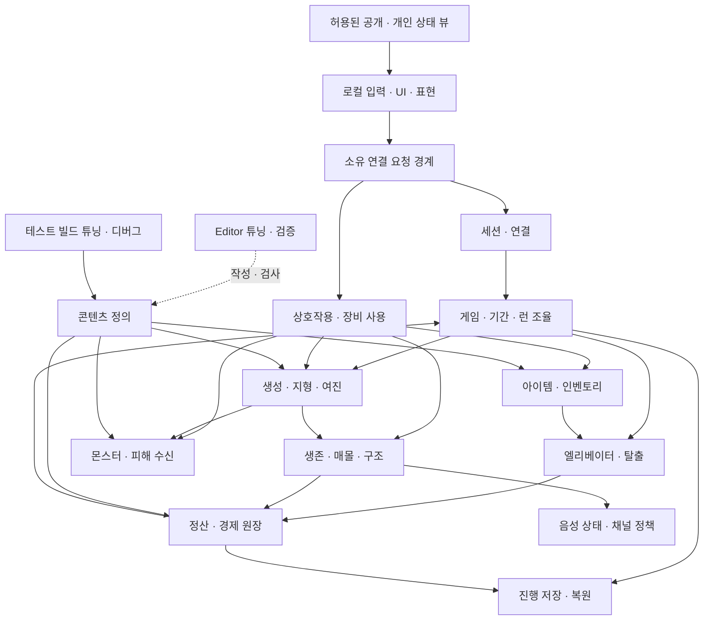

# DIGETHER 전체 시스템 설계

후속 구현 상태: `prototype` 브랜치의 [그레이박스 프로토타입](prototype/PROTOTYPE.md)에서 개발 기능 일부를 시험한다. 아래 `구현 전` 표시는 정식 시스템 전체 계약의 상태이며, 프로토타입의 구현·검증 결과는 연결 문서에서 별도로 관리한다. 정식 구현은 `DIGETHER/Source/DIGETHER/Game/` 아래에서 진행 중이며 도메인별 구현·검증 현황은 [구현 현황](design/IMPLEMENTATION_STATUS.md)에서 관리한다(2026-11-10 추가).

## 런 플로우 v1.0.1 반영 범위

런 흐름 기준은 런 플로우 기획서 v1.0.1(2026-11-10)이다. 6.1의 사전 제작 갱도 맵 선택·로드, 6.6의 몬스터 등장 체계, 9.4의 미스터리 박스 포식 예외를 반영했다. 던전·물품 배치는 기존 규칙을 따른다. 아래 기획 계약의 반영과 실제 구현·검증은 구분한다.

## 2026-11-06 기획 답변 반영 범위

[기획 답변 01~20·추가](planning/PLANNING_RESPONSE_2026-11-06.md)를 아래 계약에 반영했다. 사용자 전달 답변서의 대부분은 **기획 팀장 결정·팀 승인 전**이며, 경제·최초 몬스터·콘텐츠 목록·수치와 제안은 각 답변의 대기·시험 상태를 유지한다. 문서의 요구 변경은 구현·실행 검증 완료를 뜻하지 않는다. 2026-11-05까지의 구현·자동 테스트 기록은 당시 범위로 보존하며 새 계약의 충족 여부는 별도로 검사한다.

추가 적용 경계: MVP 입력은 키보드·마우스이며 답변 14의 누르고 말하기 V는 제안이지만 11/6 사용자 결정으로 V를 임시 기본키로 유지하며(Q 비움), 마이크 토글 요청과 3m 원음·25m 최대·매몰 시 먹먹함/최대 거리 절반은 Steam 음성 시험 대상이다(14). 배터리·연료·충전과 제단 헌납은 MVP에서 쓰지 않는다(09·15). 시험 목적지 유적·수정은 정식 갱도로 대체할 대상이며, 침대는 회복 없는 휴식·교류 용도다. 탐사 중 손실한 체력은 갱도에서 거점으로 귀환할 때 초기화한다(15). 몬스터 명세는 2026-11-08 기획서 2종(승인 전 초안)으로 받아 [반영 기준](planning/MONSTER_DESIGN_2026-11-08.md)에 정리했다. 몬스터·아이템 콘텐츠 1차 목록은 11/18 전달 예정이며 이 날짜는 전달 계획이고 승인·구현 완료일이 아니다(04·09). 장비 목록·가격·캐릭터 규격·치장 부위·지원 언어를 추정해 채우지 않는다.

## 2026-10-28 작업 목록 반영: 현재 설계 기준

상태: **기획 자료 기반 설계 초안, 구현 진행 중**. 2026-11-05 기준은 "시스템 작업리스트 1.1.0"과 "기획 공유 사양 2026-11-05"이며, 그보다 우선하는 [2026-11-05 사용자 결정](planning/DECISIONS.md#사용자-결정-2026-11-05)을 따른다. 작업리스트의 `확정 게임 규칙`은 해당 자료 안의 규칙 상태이며 Notion 이관·팀 승인 또는 구현 완료를 뜻하지 않는다. 시트끼리 다르면 '확정 게임 규칙' 시트를 우선하고 추가 충돌은 [기획 확인 항목](planning/DECISIONS.md#작업리스트-110-대조-기획-확인)으로 남긴다. D16·D25는 현재 시험 프로필로 구현하되 최종 재검토 대상이다. 결론 난 D는 [닫힌 결정](planning/DECISIONS.md#닫힌-결정)으로 옮겼다. 구현 상태 표기는 [사용자 결정 2026-11-05](planning/DECISIONS.md#사용자-결정-2026-11-05)를 따른다. "구현(실행 검증 일부)"는 그 이전부터 있던 문 닫힘 단계(`DoorClosing`)·문 닫힌 순간 목록 고정·문 닫힘 중 참가 잠금·1~3일차 효율 30/50/70에 쓴다. 2026-11-05 구현분(엘리베이터 문·사슬 소집·상승 레버 2개, 같은 계정 교체·거점 이탈·관전 합류, 저장 시점·슬롯, 붓기 납부·신호기, 게임 오버 흐름)은 "구현(자동 테스트 통과, M2·연출 미검증)"으로 적는다. 격리 사본 Editor 빌드와 `DIGETHER.Game` 자동 테스트 165개 실패 0까지 확인했고 실제 다인(M2)·BP·맵 연출은 확인하지 않았다(2026-11-05 기록이며 이후 변경분은 [구현 현황](design/IMPLEMENTATION_STATUS.md)을 따른다). 아직 코드가 없는 규칙만 "기획 기준(구현 진행 중)"으로 남긴다. 기획 운영 원본은 Notion이며 원문 URL·승인 개정은 아직 등록되지 않았다. 셀별 출처는 로컬 작업 기록에 둔다. 기존 DG 요구 ID와 새 S/D/T ID는 각각 다른 체계다.

### 2026-10-29 보정: Steam 판매 기준과 요청 처리 단순화

사용자는 2026-10-29 **Steam 판매**를 출시 방향으로 정했다. 정식 App ID, 세션 서브시스템(내장 OnlineSubsystemSteam 또는 EOS), Steam Cloud 사용 여부는 미결이며 [결정 목록](planning/DECISIONS.md)에서 관리한다. 음성은 2026-11-04 사용자 결정으로 엔진 기본 VoIP를 쓴다(1차 구현, 실제 음성은 M3 미검증). 호스트형(리슨 서버) 1~4인 구조를 유지하며 데디케이티드 서버(소스 빌드 엔진 필요)는 현재 범위가 아니다.

요청 처리는 UE 기본 복제 모델에 맞춰 단순화한다. 클라이언트는 소유 PlayerController/Character의 Server RPC로 의도만 보내고, 호스트는 그 RPC 안에서 호출자·단계·거리·대상의 **현재 상태**를 검사한 뒤 같은 실행 안에서 반영한다. 호스트 게임 로직은 게임 스레드에서 차례로 실행되므로 한 함수 안의 검사·차감·지급은 중간 상태를 다른 요청에 노출하지 않는다. Reliable RPC는 엔진이 유실·중복 없이 전달하지만 순서는 같은 액터 안에서만 보장되므로, 다른 액터를 거친 요청 간 선후는 가정하지 않고 도착 시점의 상태로 다시 검사한다([네트워크 권위](unreal/NETWORK_AUTHORITY.md)). 연결이 끊기면 진행 중 RPC는 버려지고 자동 재전송되지 않는다. 이 엔진 동작은 문서·소스 근거이며 프로젝트의 별도 실행 검증은 아니다.

따라서 일반 요청에 클라이언트 요청 ID·예상 버전·준비/확정 단계·요청별 영수증을 두지 않는다. 시스템 작업리스트 1.1.0의 공통 요청 처리는 구매·획득·납부·사망·탈출·정산 요청에 고유 번호를 붙여 중복 도착을 한 번만 반영하라고 적는다. 이 보정과 어긋나므로 기획 확인 대상(PQ-35)이며, 확인 전에는 아래 현재 상태 검사·런/기간 ID 대조로 같은 목적(한 번만 반영)을 충족하는 것을 기술 기준으로 유지한다. 현재 구현은 이 기준과 일부 다르다(2026-11-10 코드 대조): 거점 시설 요청(`Server_HubFacilityRequest`)은 클라이언트가 만든 요청 ID(`FGuid`)를 함께 보내고, 붓기·레버·바닥 금화 줍기 RPC는 `PeriodId`/`RunId` 없이 서버의 현재 상태 검사만 받는다. 문서와 구현 중 어느 쪽에 맞출지는 PQ-35와 함께 결정 대기다. 한 번만 성립하는 대상(줍기·구조 점유·해금·레버)은 두 번째 요청을 "이미 주움·점유 중" 같은 현재 상태 검사로 거절한다. 구매처럼 반복이 정상인 거래는 RPC 한 건을 거래 한 건으로 처리한다. 엔진은 따로 보낸 RPC를 하나로 합치지 않으므로, 실수로 두 번 누르는 경우는 클라이언트 UI의 처리 중 표시·입력 간격과 서버의 요청 빈도 제한으로 막는다. 기간·런 경계를 넘을 수 있는 요청(구매·납부·해금·출발·회수)은 클라이언트가 본 `PeriodId`/`RunId`를 담아 보내고, 서버는 현재 값과 다르면 거절한다. 거절 사유는 소유 클라이언트에 돌려준다. 단, 화면 안내는 최소화한다: 인벤토리가 가득 차 줍지 못한 경우와 같은 물건을 동시에 주워 늦게 처리된 경우는 안내하지 않는다(답변 19, 팀 승인 전). 배치 불가 위치는 빨간색·가능 위치는 파란색으로 표시하고 이유 문구는 쓰지 않는다. 엘리베이터·정산머신·갱도 해금 머신은 배치 선택 대상에서 제외한다. 일반 입력 오류는 연결을 끊지 않고 실패 응답으로 처리하며, RPC `WithValidation`은 정상 클라이언트가 보낼 수 없는 조작 데이터에만 쓴다. 다음 ID·기록만 유지한다.

| 유지 | 이유 |
|---|---|
| 아이템 인스턴스 ID | 같은 아이템이 월드·인벤토리·회수 건 두 곳에 남지 않게 한다 |
| 게임·기간·런 ID와 일차 | 경계를 넘은 늦은 요청을 거절하고, 저장·불러오기 뒤 이전 기간·런 결과가 새 기간에 적용되지 않게 한다 |
| 엘리베이터 편 번호·사망 기록·시체 ID | 편별 성공/취소, 사망 손실과 복구를 한 번만 계산한다 |
| 런 정산 완료 기록 | 저장 복원·재접속 뒤 같은 런을 다시 정산하지 않는다 |
| 지형 revision | 비동기 메시·충돌 결과가 최신 굴착을 덮지 않게 하고 재접속·관련성 복귀 시 스냅샷을 맞춘다(프로토타입은 revision 값을 스냅샷과 함께 복제해 적용 기록으로만 쓰며, revision 비교로 오래된 결과를 거절하는 처리는 아직 없다) |

여러 프레임에 걸치는 작업(지형 메시·충돌 갱신, 저장 쓰기, Steam/플랫폼 콜백, 구조·레버 같은 진행형 행동)만 완료 시점에 현재 상태와 revision을 다시 확인한다.

Steam 판매 품질을 위해 다음을 우선 강화한다. 실제 검증은 [검증 계획](verification/VERIFICATION_PLAN.md)을 따른다.

- **서버 검증**: 클라이언트가 보낸 거리·대상·수량을 신뢰하지 않는다. 협동 게임이므로 치트 방지보다 아이템 복제·타인 방해·호스트 크래시 방지를 목표로 한다. 호스트 본인의 조작 방지는 범위 밖이다.
- **저장**: 저장 버전·손상 파일 감지, 쓰기 중 종료 시 이전 유효 파일 보존, 구버전 변환([데이터 작업](unreal/DATA_WORKFLOW.md)). Steam Cloud를 쓰면 동기화 충돌 처리.
- **재접속**: Steam UniqueId(또는 채택 제공자의 ID)로 기존 캐릭터·잔고에 연결한다. 표시 이름·IP는 식별에 쓰지 않는다. 게임 GameMode는 `AGameMode`를 상속하고 비활성 PlayerState 보관·재연결(`AddInactivePlayer`·`FindInactivePlayer`)을 재정의해 쓴다(구현, 자동 테스트 통과·2026-11-04 2프로세스 탐사 중 재접속 확인, 3~4인 M2 미검증). 상세는 [재접속 기술 계약](#재접속-기술-계약)을 따른다.
- **버전 차단**: 빌드 버전이 다른 참가자는 접속 단계에서 거절하고 사유를 표시한다.
- **접속 경로**: 공유기 뒤 친구 간 접속을 위해 Steam 릴레이(SteamSockets) 또는 채택 제공자의 릴레이를 사용한다. 프로토타입은 App ID 480에서 SteamSockets를 시험 중이며 다른 PC WAN 접속은 미검증이다([Steam 시험](prototype/PROTOTYPE_STEAM.md)).
- **호스트 이탈**: 호스트가 나가면 방이 종료되고 모든 참가자 연결이 끊긴다(호스트 이전 없음). 마지막 자동 저장에서 이어 할 수 있음을 안내한다.
- **음성 기반 몬스터 감지**: 보류한다. 2026-11-08 몬스터 기획서(승인 전 초안) 기준 최초 2종(땅거미·미스터리 박스)은 음성 감지를 쓰지 않는다. 음성 감지가 필요한 종이 정해지면 엔진 기본 VoIP가 호스트에 음성 활동 정보를 주는지부터 시험한다(PQ-13).

구현 규칙과 정의 데이터 구조는 [개발반 구현 설계](design/DEVELOPMENT_SYSTEM_DESIGN.md#구현-규칙)와 [정의 데이터와 태그](design/DEVELOPMENT_SYSTEM_DESIGN.md#정의-데이터와-태그)를 따른다.

### 논리 구성과 의존 방향

화살표는 요청·결과 또는 정의의 흐름이며 소유자의 내부 상태를 직접 수정하는 권한을 뜻하지 않는다. 런 조율자는 단계와 전환을 담당하며 아이템 이동·피해·거래 계산을 각각의 소유자에 위임한다. Editor 도구는 정의를 작성하고 검증하며 런타임은 Editor 모듈에 의존하지 않는다. 테스트 빌드의 튜닝·디버그 실행 경로는 별도로 두고, 변경은 호스트 권한을 통해 확정한다. 테스트용 강제 실행과 디버그 표시는 실제 권한 경계와 분리하고 개발 환경에만 노출한다.

### Unreal 배치 후보와 수명

아래는 구현 착수 시 비교할 후보이며 현재 클래스·API 구현 또는 새로운 엔진 지원 검증 결과가 아니다. 실제 엔진 지원·기존 코드 근거는 [엔진 기능 활용 범위](design/UNREAL_FEATURE_COVERAGE.md)와 [프로필](project/PROJECT_PROFILE.md)을 따른다. 현재 엔진 기준은 UE 5.8.4이며 5.8.2 시점의 조사는 그 시점 사실로 읽는다([ADR-003](decisions/ADR-003-engine-version-5.8.4.md)).

| 구성 후보 | 책임과 수명 | 권위·전달 경계 |
|---|---|---|
| 로컬 GameInstance / Subsystem | 접속 UI, 제공자 연결과 로컬 설정. 프로세스/게임 인스턴스 수명 | 각 클라이언트에도 존재하므로 값 자체는 권위 아님. 서버에서 게임 컨텍스트를 보존할 후보로 쓰더라도 월드 전환과 종료 정리를 명시 |
| 호스트 GameMode 계열 | 현재 월드의 단계 진입, 출발·종료 조건 조율 | 권위에서만 실행하는 후보. 클라이언트 UI의 직접 데이터 원본이 아님 |
| GameState 계열 | 공개 단계·일차와 승인된 공통 표시 상태 | 필요한 공개 뷰만 전달. 개인 장부를 공개 복제하지 않음 |
| PlayerState 계열 | 플레이어 ID에 연결되는 공개 상태와 관전 표시 후보 | 소유 연결·맵 전환 시 복원 범위를 검증. 개인 금액을 무조건 넣지 않음 |
| 소유 PlayerController | 로컬 입력과 해당 연결에서 발생한 서버 요청 | 서버는 연결에서 호출자를 결정하고 본문이 주장하는 다른 ID를 신뢰하지 않음 |
| Character/Pawn 및 컴포넌트 | 현재 신체·이동·시점·장착 표현과 입력 보조 | 파괴·재생성 가능. 잔고·사망 기록·정산 완료 기록의 유일한 소유 위치로 사용하지 않음 |
| 서버 도메인 서비스 / 명시적 게임 컨텍스트 | 기간·장부·아이템 소유·런 종료 및 중복 방지 | 호스트 권위 데이터. 월드 또는 프로세스 수명과 전환 인계 방식을 구현 시 선택. 내부 서비스 메모리가 자동으로 복제된다고 가정하지 않음 |
| 월드 Actor / 지역 상태 | 지형, 엘리베이터, 몬스터, 월드 아이템·설치 장비 | 관련 수신자에게 필요한 상태·버전을 전달. 연출 파편은 권위 판정과 분리 |
| 소유자 전용 뷰 | 개인 잔고·허용 인벤토리·거래 결과 | 올바른 연결만 수신. 재접속·관련성 복귀 때 최신 뷰를 구성하고 이전 소유자에게 전달하지 않음 |
| 정의 자산 / Editor 도구 | 승인된 아이템·몬스터·지역·튜닝 정의, 검증과 디버그 지원 | 고정 정의와 런타임 인스턴스를 분리. Editor 의존성이 게임 빌드에 유입되지 않도록 모듈 경계를 검사 |

### 세션·게임·런·월드 인계

| 경계 | 유지·인계할 논리 데이터 | 종료와 실패 조건 |
|---|---|---|
| 세션 연결 | 세션 ID, 호스트·참가자 고유 ID, 연결과 크레딧 상태, 현재 게임 ID, 방 공개 범위(초대 전용·친구 공개·공개), 선택한 진행 슬롯(새 게임 또는 저장 진행) | 같은 ID가 다시 들어오면 이전 접속을 끊고 새 접속 수락(사용자 결정 2). 신규 참가는 정상 거점 준비 상태에서만 받고, 게이지 완료부터 출발 전환·로딩·탐사·정산·실패 사건·크레딧 동안 거절(문 닫힘 중 참가 잠금은 구현(실행 검증 일부), 게임 오버 중 잠금·관전 합류·같은 ID 교체는 구현(자동 테스트 통과, M2 미검증)). 거점 퇴장·끊김은 캐릭터 제거·자리 반환·소지 장비를 그 자리에 실물로 남김(장비 남기기는 인벤토리 미구현이라 아직 없음), 탐사 출발 후 퇴장·끊김은 캐릭터·자리 유지. 재접속은 기존 캐릭터와 현재 자산·사망/정산 상태를 연결. 호스트 이탈 시 방 종료·연결 종료 안내 |
| 게임 / 기간 | 게임·기간 ID, 일차·목표·누적 인정액·마감 결과, 개인 장부, 팀 해금·목적지, 저장 개정 | 목표 달성은 거래 확정과 새 기간 생성·1일차를 함께 처리. 이전 기간 거래의 늦은 완료는 새 기간에 적용하지 않음 |
| 탐사 / 월드 | 런 ID·시작 일차(전체·기간)·출발 인원, 생성 결과와 지형 버전, 플레이어 상태, 아이템 위치, 회수 건과 종료 사건 | 월드 생성과 모든 참가자의 준비가 완료돼야 최초 하강. 공통(호스트·공통 맵) 로딩 실패는 확정된 구매·납부·해금과 기록한 4일차 마감을 유지한 채 같은 일차 거점으로 복귀, 일차 비소비. 개인 로딩 실패와 문 닫힘 뒤 로딩 중 끊김은 나머지 출발을 취소하지 않고 출발 인원·캐릭터·자리를 유지한다. 해당 캐릭터는 엘리베이터 안에서 시작하고 재접속 시 같은 캐릭터로 복귀한다. 함께 상승하면 생존 귀환, 탐사 종료 때 갱도·던전에 남으면 실종(사망 손실 적용)이다(답변 16, 팀 승인 전·구현 대조 필요). 공통 로딩 실패 복귀는 메모리 기준점으로 구현(자동 테스트 통과)했지만 실제 로딩 계층이 없어 호출 경로는 아직 없다. 일차 시작 기준점 전체 복원 규칙은 폐기 |
| 런 종료 → 거점 | 종료 원인, 생존/사망, 편별 유효 회수 건(목록 + 지상 도착), 일반·히든·시체 회수 결과, 런 정산 완료 기록 | 종료와 일차 증가는 한 번. 정산·복구금·부활·귀환 판정 뒤 저장. 전멸은 판매용 회수품과 일반·히든 수익을 지급하지 않지만 유효 시체 복구금은 지급 |
| 게임 오버 → 새 게임 | 고정된 이전 결과, 참가자별 크레딧 상태, 새 게임 ID와 초기화 완료 기록 | 크레딧은 현재 참가자 전원이 함께 보고 호스트만 빨리감기한다. 크레딧 종료 시 호스트가 현재 슬롯만 한 번 새 게임으로 초기화. 중복 신호는 재초기화하지 않음. 떠난 사람은 기다리지 않고 출발 잠금 조건에서도 제외. 크레딧 중 끊긴 사람이 새 게임 거점에 돌아오면 정원·버전·상태를 검사한 신규 참가이며, 새 게임 시작 장비를 한 번 지급하고 이전 게임 기록은 결과 보관에만 남긴다(답변 17, 팀 승인 전) |

대기실에서 게임 맵으로의 이동은 Seamless 이동이다(2026-11-06 사용자 결정, 구현: 대기실 GameMode `bUseSeamlessTravel`, 세션 서브시스템의 `ServerTravel`). 현재 시험 구성은 게임 맵 `L_Hub` 하나에 갱도 `L_Mine`을 항상 로드되는 하위 레벨로 둔 단일 월드이며, 게임·런·명단·정산 완료 기록은 그 월드의 GameMode가 가진다. 이 단일 월드 구성을 확정할지, 거점↔갱도를 별도 맵으로 나눌 때 데이터를 어디에 두고 어떻게 넘길지는 후보 비교 후 결정한다(결정 대기). 동일 시드만으로 모든 플랫폼의 생성·충돌 결과가 같다고 가정하지 않으며 기준 상태와 변경 버전, 복구 방법을 실제 구현에서 검증한다.

### 재접속 기술 계약

답변 20 기준 수락 시점은 호스트가 참가 요청을 수락 처리한 순간이며 Steam 초대 수락 순간이 아니다. 수락·참가 완료가 모두 게이지 완료 전이면 정상 참가, 수락만 전이면 빈자리에서 관전 참가, 수락이 게이지 완료 후이면 사유와 함께 거절한다. MVP에서 관전 접속이 불가능하면 임시 거절한다(팀 승인 전·실접속 검증 필요).

요구는 같은 고유 ID로 연결을 복원하고, 끊긴 캐릭터를 남겨 그동안의 사망·탈출·정산을 유지하는 것이다. ID 원천과 플랫폼 계정 매핑·인증은 제공자 선정 시 결정한다. 호스트의 재접속 레지스트리는 세션 수명 동안 참가 ID와 연결 상태, 캐릭터·장부 및 현재 상태를 유지하고 표시 이름이나 IP 주소를 식별 근거로 삼지 않는다. 게임 빌드 버전 불일치는 거절한다. 동일 ID의 동시 연결은 사용자 결정 2(2026-11-05, 기획 답변 C2와 같음)에 따라 **이전 접속을 끊고 새 접속을 받는다**. 시스템 작업리스트 1.1.0 S01의 "이미 연결된 ID의 추가 접속은 거절"은 기획이 다음 버전에서 고칠 항목이므로 따르지 않는다. 구현(자동 테스트 통과, M2 미검증): `PreLoginAsync`에서 이전 연결을 끊고 정리를 기다린 뒤 새 접속을 수락한다(교체 대기 제한 5초는 임시값). 엔진 `AGameSession::KickPlayer`를 그대로 쓰면 Pawn을 먼저 파괴해 끊긴 캐릭터·비활성 PlayerState 유지 계약을 깨므로 쓰지 않는다([네트워크 카탈로그](unreal/features/NETWORKING.md)). '같은 계정이 이미 접속 중' 문구(아래 ②)는 교체 대기 제한 안에 이전 접속을 끊지 못한 경우와, 정리를 기다리는 사이 같은 ID가 다시 활성화된 경우에만 쓴다(구현 기준). 탐사 출발 후 끊긴 참가자는 탐사 중에도 빈자리 검사 없이 재접속한다. 거점에서 떠났던 기존 참가자는 빈자리를 검사하고, 탐사 중 돌아오면 그날 탐사·출발 인원에 넣지 않고 관전하며 기다린 뒤 거점에서 복귀한다. 거점 퇴장으로 반환한 자리를 다른 사람이 채웠다면 정원을 넘겨 들어올 수 없다. 탐사가 끝나 거점에 돌아왔는데도 미접속이면 캐릭터를 정리하고 자리를 반환한다(이 정리·자리 반환은 아직 구현되지 않았다. 2026-11-10 코드 대조: 귀환 처리는 끊긴 참가자의 Pawn만 옮기고 자리는 게임 오버 뒤 새 게임 전환 때까지 유지된다. 수정 대상). 튜닝 값 버전이 다르면 경고하고 호스트 기준 값을 동기화한다. 재접속은 인증 → 기존 레코드 검색 → 연결이 끊긴 상태 확인 → 남은 Pawn에 재빙의 또는 이미 사망/탈출했다면 해당 최신 상태 복구 → 허용 뷰와 지역 상태 재전송 순서다. 신규 참가의 자리 배정·생성·지급을 다시 실행하지 않는다. 미접속 참가자 레코드는 이후 저장에도 보존한다. 불러온 저장의 참가자가 같은 ID로 입장하면 저장된 레코드에 연결하고 초기 지급을 반복하지 않는다.

엔진의 기본 연결 종료 경로는 PlayerController의 Pawn 정리를 동반할 수 있고, `AGameMode`의 기본 비활성 PlayerState 수명·식별 대조만으로는 위 요구를 충족하지 않는다(UE 5.8.2 소스 조사 근거). 그래서 게임 GameMode는 `AGameMode`를 상속하되 다음처럼 재정의했다(구현): 탐사 중 끊긴 참가자는 PlayerState 원본과 남은 Pawn을 수명·개수 제한 없이 비활성 보관하고 같은 ID가 돌아오면 원본에 다시 연결한다. 거점에서 떠난 참가자는 PlayerState를 파괴하고 값 레코드만 남긴다. 자동 테스트와 2026-11-04 2프로세스 탐사 중 재접속까지 확인했고 3~4인 M2(제3자가 보는 끊긴 캐릭터의 상태, 비공개 값)는 검증하지 않았다. 기존 템플릿의 재접속 실험은 새 ID 참가 관찰이므로 T55의 동일 ID 재접속 통과가 아니다.

### 튜닝 데이터와 테스트 환경 R01~R14

기획자는 채택된 기능과 D16·D25 시험 프로필을 코드 수정·재빌드 없이 조정한다(R01). 채택 미정 기능과 기본값 공란은 승인 전 구현하거나 승인값으로 채우지 않는다. 플레이어 공통·장비별·몬스터 종별 정의를 분리하고(R02), 각 파라미터 ID를 엔진 필드에 1:1로 연결해 이름이 다르면 매핑을 기록한다(R03). 단위·설명·최소/최대·적용 범위·런타임 변경 Y/N·정의 버전을 레지스트리에 둔다(R09~R10). 잘못된 값은 거절하거나 경고하며 음수 속도/시간과 0 이하 간격을 허용하지 않는다. 중량-속도 등 곡선은 편집 가능한 곡선으로 제공한다(R11).

R04/R13 판정 값은 호스트가 권위를 갖는다. 런타임 변경 Y 값은 호스트에서 유효성을 확인하고 동일 버전으로 동기화하며, 화면 전용 설정은 분리한다. 버전이 다른 클라이언트는 경고한다. 다인 테스트 빌드에서도 변경·동기화와 선택적 디버그 표시가 동작해야 하므로 Editor 모듈 없이 읽을 수 있는 런타임 데이터·테스트 전용 제어 경로를 둔다. 변경 이력을 비교할 수 있는 CSV/JSON 등 텍스트 원본과 엔진 데이터 가져오기·검증 경로를 후보로 비교한다(R14). 원본과 산출물 불일치·버전 충돌은 경고하고 기준을 결정하기 전 자동 덮어쓰지 않는다. 프로필은 묶음 저장·전환하고 테스트 빌드 입력은 별도 프로필로 기록한다(R12, 권장).

운행 횟수와 사망/복구 비율처럼 탐사별 결과를 고정하는 값은 거점에서 변경하고 런 생성 시 버전 있는 프로필 스냅샷에 보관한다. 엘리베이터 횟수(ELV_ASCENT_LIMIT), 탐사 제한 시간(RUN_TIME_LIMIT), 사망 손실(PLY_DEATH_LOSS_RATIO)·시체 복구 비율(CORPSE_REFUND_RATIO)은 런 시작 시 고정하고 진행 중 소급 변경하지 않으며 사망·정산 재처리에도 같은 스냅샷을 사용한다. 시간 제한·상승 시간 차감량은 런 설정과 실제 적용 버전을 기록한다. 런타임 조정 가능 항목은 승인된 적용 시점과 변경 사건을 기록하여 재현하며, Y/N을 임의로 바꾸지 않는다. 일반 상승은 2회로 확정되어 1회 비교 프로필은 쓰지 않는다(`ELV_ASCENT_LIMIT` 표기는 PQ-36). 맵 생성 때 정해지는 `MON_SPIDER_NEST_CHANCE`가 런타임 Y로 적힌 점은 PQ-37로 확인한다.

몬스터 BT의 노드 구성은 미설계다. 노드형 편집기를 이용해 테스트 조건·순서를 코드 없이 바꾸고(R05), 종별 데이터 참조와 명시적 노드 덮어쓰기(R06), 지원 노드·기존 데이터 복제에 의한 테스트 종 생성(R07)을 제공한다. 테스트 빌드/Editor에서 시야·청각·현재 노드·대상·경로 및 랜턴 범위·상호작용 거리를 켜고 끄며 판정 범위와 일치시킨다(R08). UE Behavior Tree 편집기와 Gameplay Debugger/Visual Logger는 검토 후보이며 이 문서에서 엔진 지원·프로젝트 연결을 새로 확인한 것은 아니다. T40에서 필드·단위·범위·런타임 반영과 호스트 버전을 검증한다.

### 출발·운행·종료 장벽

출발 레버 완료 요청은 호스트가 단계·크레딧 잠금과 기간 버전을 확인한다. 진행 중인 구매·납부(붓기 입력)는 확정 또는 종료로 정리하고 하우징 배치 점유를 해제하며 미확정 배치는 이전 유효 위치를 유지한다. 정산머신은 여러 명이 동시에 붓는 방식이라 점유가 없고, 갱도 해금 머신의 목적지 패널도 아래 답변 11 기준으로 점유하지 않는다. 4일차에는 마감 판정을 그 처리 순서와 함께 확정한다. 출발 장벽과 거래가 겹쳤을 때 한쪽의 부분 결과가 다른 단계에 남지 않게 한다. 목적지는 누군가 출발 레버 조작을 시작하면 고정하고 게이지 도중 취소하면 푼다. 답변 11 기준으로 목적지 패널은 점유하지 않고 레버 시작 전 마지막 선택을 따른다. 누군가 출발 레버를 잡으면 고정하고 완료 전 놓으면 해제한다(팀 승인 전).

거점 출발의 기획 기준(시스템 작업리스트 1.1.0 S02, 사용자 결정 1)은 다음 순서다. 레버 유지 시간 T는 1~3일차 약 3초(시험 값), 4일차 2T. 레버 조작 중 1~3일차는 주황색 형광등·비프음과 팀원에게 "승강기가 곧 출발합니다", 할당량 미달 4일차는 빨간 경고등·사이렌과 레버 조작자에게 "현재 할당량 마감일입니다!"를 보이며, 개인 잔고·누가 적게 냈는지는 넣지 않는다.

1. 게이지 완료: 확정된 거래를 반영한 뒤 구매·납부·신규 참가 접수를 닫고, 열린 상점·외형·납부 창을 닫고, 거점 전원의 기본 조작 안내를 지운다. 수동 출발 취소는 받지 않는다. 4일차에 같은 처리 시점의 마지막 납부는 먼저 판정해 달성하면 새 사이클 1일차로 바꾸고 그대로 출발하며, 미달이면 마감 결과를 기록한다(마감 시점 표현 차이는 PQ-22).
2. 문 닫힘: 고정 시간(`LOBBY_DOOR_CLOSE_TIME`, 임시 3초) 동안 문이 닫히며 그동안 걸어서 탈 수 있다. 권양기·사슬 소리로 예고한다. 남은 인원에 따른 빠르기 구분과 문턱 밀어내기는 없다(밀어내기는 사용자 결정 1로 폐기).
3. 문 닫힘 완료: 거점에 있으면서 엘리베이터 밖에 있는 참가자 전원을 사슬 소집으로 엘리베이터 바닥 안쪽 빈 위치에 순간이동 1회로 옮긴다(이동 중 충돌 판정 없음, 빈 위치가 없으면 겹침 허용·서로 밀어냄, 고정 착지 지점 없음). MVP는 암전 후 순간이동. 엘리베이터 안에 놓인 물품(공용 장비 포함)도 함께 내려간다. 이미 떠난 사람과 관전 합류 대상은 소집하지 않는다.
4. 출발 인원 N 확정: 직접 탑승 + 사슬 소집, 자리를 비운 참가자 포함. 일반 화물 분배와 1인 3단계 매몰 즉사 판정의 기준이다.
5. 런 ID 생성·사전 제작 갱도 맵 중 하나 선택·로드·기존 규칙에 따른 던전/물품 배치 → 모든 참가자 로딩 확인 → 최초 하강(개인 로딩 실패를 언제 확정하고 하강하는지는 PQ-39). 갱도 목재(무료)는 갱도 도착 후 엘리베이터 옆에 탐사마다 한 번만 놓는다.

문 닫힘 단계와 문 닫힘 중 참가 잠금은 구현(실행 검증 일부)이다. 레버 한 번 완료로 자동 닫힘, 출발 `LOBBY_DOOR_CLOSE_TIME`·상승 `ELV_DOOR_CLOSE_TIME` 각 3초(임시), 게이지 완료 뒤 취소 불가·거래와 창 닫기, 사슬 소집, 1~3일차 출발 경고는 구현(자동 테스트 통과, M2·연출 미검증)이다. 사슬 소집은 MVP 순간이동이며 클라이언트 암전은 BP 이벤트 `OnChainSummoned` 연결이 필요하다. 경고는 `WarningKind`로 복제하고 형광등·소리 연출 BP가 필요하다. 이 출발 방식과 문 닫힘·예고·소집 연출 길이는 플레이테스트 결과로 바뀔 수 있다.

일반 편은 `대기 → 게이지 완료 → 문 닫힘 진행(탑승 가능) → 문 완전 닫힘/명세 고정 → 상승 → 도착 성공`으로 모델링한다. 문 완전 닫힘 뒤에는 출발을 취소하지 않으며 거점 공통 로딩 실패만 예외다(답변 06, 팀 승인 전). 문 닫힘 시간은 `ELV_DOOR_CLOSE_TIME`(임시 3초)이다. 문 닫힘 단계(`DoorClosing`)와 문 닫힌 순간 목록 고정은 구현(실행 검증 일부)이며 문턱 밀어내기는 폐기했다(사용자 결정 1). 게이지 중 무게 초과는 게이지 0, 문 닫힘 중 무게 초과는 문 재개방·게이지 0이며 둘 다 상승 횟수에 넣지 않는다. 갱도 상승 레버는 엘리베이터 안과 밖에 하나씩 두고 같은 규칙(U초 유지·무게 검사·문 닫힘 후 목록 고정)으로 동작하며, 안팎 동시 입력도 한 편만 출발한다. 밖의 레버를 당긴 사람은 갱도에 남으므로 화물만 올려 보낼 수 있다. 답변 06·추가 기준으로 밖의 레버는 1차 상승에만 쓰고 2차(마지막) 상승은 내부 레버로만 출발한다. 화물만 실은 편과 빈 편도 상승 1회·시간 감소를 적용하고 무게 초과 재개방 시도는 제외한다. 동시 레버 요청은 안내 없이 한 건만 받고 안내가 겹치면 무게 초과 경고(덜컹 연출)를 우선한다(팀 승인 전. 밖 레버의 마지막 상승 거절은 서버에 구현했고, 그 밖의 새 예외는 구현 대조 필요). 갱도에서는 사슬 소집이 없고 문 닫힘 완료 때 안에 있는 사람만 상승한다. 구현(자동 테스트 통과, M2 미검증): 상승 2회 고정, 안·밖 레버 중 먼저 잡은 레버만 진행, 문 닫힘 중 무게 초과 재개방(두 레버 초기화), 문 닫힘 완료를 같은 처리 시점의 시간 종료보다 먼저 판정. `L_GameTest`에 밖 레버를 배치했다. 화물 적재 기능이 없어 화물 회수는 규칙 단위로만 확인했다.

상승 중에도 피해·사망이 가능하다(무적 없음). 정차 중(문 닫힘 구간 포함)에는 몬스터가 들어올 수 있고 상승할 때 입구 쪽으로 밀려나 갱도에 남는다. 엘리베이터 안의 시체는 땅거미의 회수 대상이 아니다. 목록에 있던 탑승자가 상승 중 죽으면 사망으로 기록하고 그 시체가 지상에 도착하면 시체 회수로 판정한다. 유효 회수는 회수 목록에 있고 실제로 지상에 도착한 것만이며(시체·화물 공통), 문 닫힘 뒤 새로 실은 것과 상승 중 밖으로 빠진 것은 인정하지 않는다. 이 항목들은 기획 기준(구현 진행 중)이다. 탑승자는 운행 중 별도 상태로 기록하며 목록 고정과 실제 탈출 성공을 구분한다. 결론 나지 않은 운행이 남았으면 탐사 종료 확정 자체를 기다리는 기술 장벽을 둔다. 종료 확정 순간 생존자를 고정하고 일차를 한 번 증가시킨 뒤 정산한다.

시간 종료 처리: 갱도 대기 중(문 닫힘 중 포함)이면 그 순간의 사람·화물로 무게를 검사해 정상이면 자동 귀환, 초과면 사출한다. 문 닫힘 완료와 시간 종료가 같은 처리 시점이면 문 닫힘 완료를 먼저 판정한다. 상승 중이면 해당 편을 마치고 추가 회수 건을 만들지 않으며, 탑승자를 시간 초과만으로 실종 처리하지 않는다. 활동 인원 0명으로 종료하면 문 닫힘 완료로 이미 상승이 확정된 편만 지상까지 운행하고, 대기 중·문 닫힘 중인 편의 화물·시체는 회수하지 않는다. 마지막 생존자가 엘리베이터 안에서 죽어도 생존 귀환자가 0명이면 전멸이다. 호스트가 목록 고정·시간 종료 시점의 위치와 튜닝된 탑승 영역을 기준으로 내부 여부를 판정하고, 끊긴 캐릭터와 소지품을 포함하되 손에 든 물건을 바닥 화물로 중복 합산하지 않는다. 문턱 범위는 플레이 테스트 값이다.

호스트 단일 시계의 남은 제한 시간으로 여진 일정을 계산한다. 상승 확정당 시간 감소를 한 번 적용하면 여진 일정을 새 남은 시간에 맞춰 재평가하고 0이 되면 진행 편은 유지한 채 시간 종료를 한 번 처리한다. 첫 상승 후 여진 간격 배율은 별도의 테스트 값으로 관리하며 기본값은 미정이다. 제한 시간은 최초 하강을 마치고 갱도에 도착한 순간부터 흐르며 첫 사람이 나갈 때까지 기다리지 않는다(기획 공유 사양 2026-11-05, 구현(자동 테스트 통과)). 2차 상승이 끝나면 남은 시간과 무관하게 탐사를 끝낸다. 남은 시간은 숫자로 보이지 않고 갱도의 흔들림·소리로만 드러나며, 던전에는 흔들림·소리를 전달하지 않는다.

### 저장 기준점과 복구

시스템 작업리스트 1.1.0 S30 기준이다: 수동 저장은 없고 자동 저장만 한다(개발용 치트 명령은 Shipping에서 제외, 사용자 결정 3). 호스트는 방을 만들 때 새 게임 또는 저장된 진행을 고르며 진행 슬롯은 여러 개다(최대 개수 미정). 자동 저장 시점은 다음 넷이다. 2026-11-14 [런 플로우 v1.1.0](planning/RUN_FLOW_2026-11-14.md)는 **새 게임 생성 직후**와 **현재 슬롯 새 게임 초기화 직후**(초기 상태·지급 내역)를 더해 여섯으로 늘렸다. 최초 저장 실패도 알림·재시도·기존 유효 저장 보존을 따르고 실패한 최초 저장을 재개 지점으로 표시하지 않는다(미구현).

구현(자동 테스트 통과, M2 미검증): 탐사 정상 완료 후·할당량 달성·호스트 거점 종료 자동 저장, 실패 시 알림과 10초 간격 재시도(임시값, 출발 막지 않음), 4일차 마감을 게이지 완료 시점에 기록, 저장 wire v5와 진행 확장(전체 일차·기간 일차, 구 v3·v4는 기간 일차로 추정), 저장 슬롯 3개(임시값, 슬롯 0은 기존 이름 유지), 방을 만들 때 새 게임/이어하기 선택. 선택 화면은 WBP 위젯 추가가 필요하다. 답변 05는 시설 거래마다 저장하는 경로를 폐기하고 아래 네 시점만 쓰도록 요구한다(팀 승인 전). 시설 거래별 저장 API `SaveHubFacilityProgress`와 그 호출은 11-06 코드 변경에서 제거했다(2026-11-10 소스 검색 0건). 11-06 이후 변경분의 충족은 위 11-05 테스트 결과로 주장하지 않으며 [구현 현황](design/IMPLEMENTATION_STATUS.md)의 증거를 따른다.

| 시점 | 함께 기록 |
|---|---|
| 새 게임 생성 직후 · 슬롯 새 게임 초기화 직후 | 일차·할당량·잔고·개인 시작 장비·공용 무료 장비·해금·통계 초기 상태와 지급 내역(v1.1.0, 미구현) |
| 탐사 정상 완료 | 일차 변경·정산·지급 완료 기록·부활·거점 귀환 판정을 모두 반영한 뒤 한 번 |
| 할당량 달성 | 잔고 차감·새 목표·1일차 전환·바닥 초과 금화 수량과 위치를 한 번에 |
| 호스트의 정상 거점 종료 | 마지막 자동 저장 이후 구매·납부까지 포함한 현재 진행 |
| 5일차 실패 귀환 | 귀환 자동 저장에 게임 오버 확정 상태 포함, 저장 뒤 조작 복구(답변 08, 팀 승인 전) |

탐사 중 상태와 정산 중간 상태는 저장하지 않는다. 호스트가 탐사 중 종료하면 다음 실행은 마지막 정상 완료 저장에서 시작한다. 답변 18은 호스트 소유 협동 게임이므로 별도 종료 악용 대책을 두지 않는다고 답했다(팀 승인 전). 일차 시작 기준점으로 구매·납부까지 되돌리던 전체 복원 규칙은 폐기했다. 공통 출발 로딩 실패는 실행 중인 방에서 준비 내용과 4일차 마감을 유지한 채 같은 일차 거점으로 돌아가는 처리이며 디스크 저장으로 되돌리지 않는다. 저장 항목은 기간·전체/기간 일차·목표·공동 인정액·마감 결과, 개인 잔고·히든 누적 수익·장비·통계·사망/복구·런 정산 완료 기록, 팀 해금·목적지·거점 배치, 남은 공용 무료 장비 수량·긴급 삽 사용 여부·진행별 구매 치장과 착용 상태·바닥 초과 금화·안내/툴팁 표시 완료, 미접속 참가자 기록이다. 답변 05 기준으로 거점 바닥 물품의 종류·수량·위치·방향도 저장하며 지형에 끼거나 맵 밖에 있는 물품은 불러올 때 엘리베이터 안에 놓는다. 구매·해금·배치 뒤 강제 종료는 마지막 저장으로 돌아가도 된다(팀 승인 전·새 저장 항목은 구현 대조 필요). 개인 기본 외형은 진행 저장과 분리한다. 이어하기 때 저장 당시 각자 소지한 장비는 엘리베이터 안에 실물로 모아 복원하고 공용 무료 장비는 남은 수량만 복원한다.

플레이 중 자동 저장 실패는 알림 후 계속 재시도하며 이전 유효 저장과 현재 플레이를 보존하고 출발을 막지 않는다. 오래된 재시도가 더 최신 저장을 덮지 않게 한다. 호스트 종료 저장 실패는 알린 뒤 저장 없이 종료한다. 게임 오버 이전의 고정 결과는 새 게임 초기화와 분리해 보존하고, 게임 오버 뒤 새 게임 초기화는 현재 슬롯에만 적용한다. 게임 오버 확정이 저장된 진행은 다음 실행에서 같은 슬롯 새 게임으로, 확정 저장이 실패했다면 마지막 유효 저장에서 이어간다. 불러오기 실패 때 기존 저장을 새 게임으로 덮어쓰지 않는다. 장애·미접속 레코드·실패 귀환 불러오기를 검증한다.

### 기능 소유 매핑과 착수 단위

| 기능 ID | 주 소유 영역 | 연결·착수 시 필요한 계약 |
|---|---|---|
| S01 | 세션 | 방·연결·재접속과 ID, 게임 컨텍스트 복원 |
| S02 | 런·기간 | 출발 게이지·문 닫힘·사슬 소집·출발 인원 확정·일차와 마감, 목적지 |
| S03 | 플레이어 | 이동·시점·체력과 스태미나, 생존 제한 |
| S04 | 상호작용 | 탐색과 서버 자격 검증, 점유·취소 |
| S05 | 월드 준비 | 사전 제작 갱도 맵 선택·로드, 기존 규칙의 던전·물품 배치, 갱도·던전 연결·준비 검증·실패 처리 |
| S06 | 장비·표현 | 채택 광원과 환경 장치, 설치 상태 |
| S07 | 지형 | 갱도 허용 3D 흙 볼륨의 실제 제거·메시·충돌과 던전 지정 벽 파괴 |
| S08 | 지형·보강 | 설치·손상·무료 보수와 소모 거래. 2026-11-14 런 플로우 v1.1.0에서 Could로 낮춰 현재 범위 밖 |
| S09 | 지형·시간 | 여진 일정·붕괴·재굴착, 충돌·경로 갱신 |
| S10 | 생존·구조 | 매몰 단계, 단독 점유와 취소·사망 경합 |
| S11 | 아이템 | 일반·헤드랜턴 슬롯과 인스턴스 보관 |
| S12 | 아이템·플레이어 | 중량·양손 제한과 이동 속도 |
| S13 | 아이템 | 히든 칸·비공개 뷰·중량 |
| S14 | 아이템·월드 | 배치·획득·낙하·유형별 보존 |
| S15 | 엘리베이터 | 운행 상태·횟수·중량·시간 감소 |
| S16 | 엘리베이터·아이템 | 문 완전 닫힘 순간 명세 고정·목록 + 지상 도착 유효 회수·편별 성공/취소 |
| S17 | 탈출·생존 | 개인 탈출·관전 전환·장비 제한 |
| S18 | 런·생존 | 시간 종료·사출·전멸·일차 전환 |
| S19 | 경제 | 유효 화물·출발 인원·생존자 정산 |
| S20 | 경제·아이템 | 개인 히든 지급과 지속 장비 보존 |
| S21 | 생존·경제·아이템 | 사망 사건·드롭·지갑 손실 |
| S22 | 생존·경제 | 시체 운반·복구·관전·부활 |
| S23 | 경제·아이템 | 개인 구매와 차감·인스턴스 발급 |
| S24 | 기간·경제 | 동시 붓기 납부·목표 달성·4일차 마감·실패 |
| S25 | 몬스터·월드 | 종별 정의·생성·행동·동적 지형 경로 |
| S26 | 장비·생존·몬스터 | 동일 입력의 굴착/공격 판정·팀킬 |
| S27 | 장비·아이템 | 설치·사용·보존, 자원 채택 여부 |
| S28 | 음성 | 거리·관전 채널·제공자 연결 |
| S29 | 표현·UI | 허용 정보·경고·결과와 안내 |
| S30 | 저장 | 완료 상태·버전·복원과 권한 |
| S31 | 로컬 설정·표현 | 입력·음향·접근성과 오류 |
| S32 | 개발 검증 | 재현·로그·데이터 검증, 권한 분리 |
| S33 | 게임 흐름·표현 | 실패 결과 고정·크레딧·새 게임 생성 |
| S34 | 외형 | P2 동기화·판정 분리·저장 범위 결정 |
| S35 | 거점 배치 | P2 권위 점유·공간 검증·저장 복구 |

S01 참가 거절은 아래 6종으로 구별한다. 신규 참가 판정은 요청을 수락한 시점의 상태로 한다: 게이지 완료 전 수락·확정이면 거점 합류, 수락은 전·확정은 후면 빈자리가 있을 때 관전 합류(그날 N·수익 제외, 탐사 종료 후 거점에서 캐릭터 생성·시작 장비 1회), 수락이 완료 이후면 거절. MVP에서 관전 접속을 지원하지 못하면 관전 합류 대상도 임시로 거절하고 사유를 안내한다. 관전 합류 빈자리는 탐사 출발 후 끊긴 기존 참가자의 자리를 빼고 계산한다. '수락'은 호스트가 참가 요청을 수락 처리한 순간이며 Steam 초대 수락 순간과 구별한다(답변 20, 팀 승인 전).

S02의 시작 장비는 한 번만 지급한다: 개인 삽 1·헤드랜턴 1(곡괭이 제외), 새 게임 때 엘리베이터 안 공용 삽·곡괭이·헤드랜턴 각 4개(일일·방 재생성 때 보충 없음), 부활 때 삽·헤드랜턴 재지급(공용분과 별도). 긴급 삽은 게임 진행 전체에서 팀 공통 1회(조건 비공개)이며, 정상 로비에서 부활 장비 지급·저장 장비 복원·퇴장자 드롭을 모두 처리한 뒤 플레이어 잔고 합계 < 상점 삽 가격이고 로비(소지품·엘리베이터·공용 비치분·바닥)의 삽·곡괭이가 0개일 때 지급한다(v1.1.0 4.4절. 미접속자 보관 잔고·접근 불가 도구 산정은 후속 결정). 갱도·상점 목재 2종은 v1.1.0에서 보강과 함께 범위 밖이 됐다. 시작 잔고는 1인당 20이다(v1.1.0, 2026-11-14 사용자 채택). 새 진행 첫 참가 때 1회 주고 지급 기록(초기화된 참가자 기록)으로 재참가·재접속 중복을 막는다. 공통 출발 로딩 실패로 정상 로비가 복구되면 합류가 확정된 관전 대기자를 로비 참가자로 전환하고 캐릭터·초기 지급을 지급 기록에 따라 한 번만 처리한다(v1.1.0 3.2·5.5절). 나머지 값·가격은 D22 확인 대상이다. S05는 단일 시험 맵의 한 판 검증과 복수의 사전 제작 갱도 맵 중 하나를 선택·로드하는 검증을 구분한다. 갱도 형태를 매 탐사마다 새로 생성하지 않는다. S24는 목표 달성 시 현재 납부 입력을 끊고 새 기간에서 다시 입력해야 한다. S33 통계는 게임/플레이어 ID와 참가 순서를 기준으로 증분 누적하며 0원도 표시한다. 이전 게임 결과를 고정한 뒤 크레딧을 재생하고, 실패 사건 연출 재생 실패 시 결과 크레딧으로 넘기는 복구 경로를 검증한다(별도 실패 안내 화면은 D15 결정 전 만들지 않음).

#### 참가 실패 안내 문구

사용자 결정 3(2026-11-05)으로 6종(①계정 확인 실패 ②같은 계정 접속 중 ③탐사 중 + 정원 초과·버전 불일치·방 종료)을 확정한다. 시스템 작업리스트 1.1.0 S01은 아직 4종('참가 불가 상태' 포함)이며 ③은 그 '참가 불가 상태'에 쓴다. 6종 구분은 구현(자동 테스트 통과, M2 미검증)이다. 서버 접속 판정이 전달하는 사유 키는 계정 확인 실패·같은 계정 접속 중·탐사 중·정원 초과 4종이고, 버전 불일치와 방 종료는 서버 사유 키가 아니라 클라이언트의 세션 검색·초대·참가 결과에서 판정한다(2026-11-10 코드 대조). 정원 초과·버전 불일치·방 종료의 문구는 아직 받지 않았다. ②는 사용자 결정 2(이전 접속을 끊고 새 접속 수락)에 따라, 교체 대기 제한 안에 이전 접속을 끊지 못했거나 정리를 기다리는 사이 같은 ID가 다시 활성화된 경우에만 쓴다(구현 기준).

| 경우 | 안내 문구 |
|---|---|
| 정원 초과 | 미정 |
| 버전 불일치 | 미정 |
| 방 종료 | 미정 |
| 참가 불가 상태(③ 탐사 중) | 팀이 출발했거나 탐사 중이라 지금은 참가할 수 없습니다. 팀이 로비로 돌아온 뒤 다시 시도해 주세요. |
| ① 계정 확인 실패 | 계정을 확인하지 못해 참가할 수 없습니다. Steam 로그인 상태를 확인한 뒤 다시 시도해 주세요. |
| ② 같은 계정이 이미 접속 중 | 같은 계정이 이미 접속 중입니다. 잠시 후 다시 시도해 주세요. |

### 게임 흐름과 상태 전이

호스트가 방을 만들고 최대 4명이 참가하며 1인 완주도 지원한다. 현재 구현의 실행 순서는 메인 메뉴(`L_MainMenu`) → 대기실(`L_Lobby`, 방 만들기·참가) → 호스트의 게임 시작(Seamless 이동) → 거점(`L_Hub`)이다. 기획 자료의 '로비'는 거점을 뜻하고([용어](GAME_DESIGN.md#용어)), 게임 시작 전 인원을 모으는 화면은 '대기실'로 구분해 부른다(코드 폴더 이름은 `Game/Frontend/Lobby`). 게임 시작 뒤의 신규 참가는 아래 거점 준비 상태 규칙을 따른다. `거점 준비 → 출발 로딩 → 최초 하강 → 탐사 → 종료 확정 → 런 정산 → 거점 귀환 판정 → 거점 준비`가 기본 흐름이다. 모든 참가자가 출발 레버를 당길 수 있고 준비 확인은 없다. 게이지 완료 → 문 닫힘(탑승 가능) → 사슬 소집 → 출발 인원 확정 순서는 [출발·운행·종료 장벽](#출발운행종료-장벽)을 따른다. 공통 로딩 실패는 준비·마감을 유지한 채 같은 일차 거점으로 돌아가며 일차를 소비하지 않는다(일차 시작 기준점 전체 복원은 폐기). 신규 참가는 정상 거점 준비 상태에서만 받고 게이지 완료 순간부터 출발 전환·로딩·탐사·정산·실패 사건·크레딧 동안 막으며, 기존 ID의 재접속은 신규 참가와 구별한다. 호스트가 나가면 방이 종료된다.

일차는 전체 일차와 기간 일차(현재 할당량 기준 1~4일차)를 함께 기록하고 납부 마감·실패 판정은 기간 일차를 기준으로 한다. 탐사 종료는 활동 인원 0, 2차 상승 종료, 시간 종료의 자동 귀환 처리 완료 중 해당 사건으로 한 번 확정한다. 그 즉시 두 일차를 한 번 증가시키고 종료된 탐사 ID로 정산한다. 탐사 전체 종료 뒤 검은 화면에 본인 결과만 보이고(조작·시스템 메뉴 잠금, 다시 열 수 없음), 정산(사망 손실률 확정 포함)·지급 완료 기록·부활과 귀환 판정이 모두 반영된 뒤 자동 저장한다. 전환·로딩·검은 정산 화면에서는 시스템 메뉴를 열 수 없다. 4일차 출발 게이지 완료 시 납부를 마감하고 당시 미달을 기록한다(같은 처리 시점의 마지막 납부는 먼저 판정). 미달이어도 출발하며, 4일차 탐사 후 5일차 검은 정산 화면을 거쳐 거점에 돌아오면 귀환 자동 저장(게임 오버 확정 포함) → 실패 사건(우물 범람 → 거점 침수 → 깊은 우물로 흡입) → 함께 보는 결과 크레딧 → 현재 슬롯 새 게임 순서로 진행한다(답변 08: 저장 뒤 조작 복구, 팀 승인 전). 실패 사건 중에는 각자 이동·시점 조작을 유지하고 공통 컷신은 없으며, 먼저 흡입된 사람은 기다리고 떠난 사람은 대기 인원에서 뺀다. 목표 달성 시에는 즉시 새 목표와 1일차로 전환하고 진행 중 출발 입력을 취소한다. 결과 크레딧은 현재 참가자 전원이 함께 보며 건너뛰기·일시정지·다시 보기는 없고 빨리감기는 호스트만 조작해 모두에게 같은 속도로 적용한다. 크레딧 중 방 나가기·앱 종료는 허용하고 떠난 사람 때문에 대기하거나 출발을 잠그지 않는다. 답변 08의 크레딧은 전체 총액 → 획득 금액(히든 포함) → 히든 슬롯 획득 금액 → 사망 손실 금액 순서이며 각 블록에 참가 순서대로 `이름: 금액`을 나열한다. 순위는 없고 0원·중간 이탈자도 표시한다. 별도 할당량 미달 화면은 보류다(팀 승인 전). 이 흐름은 구현(자동 테스트 통과, M2·연출 미검증)이다: 서버가 우물 거리 기준으로 흡입 시각을 정하고 마감에 남은 사람은 강제 흡입, 떠난 사람 제외, 크레딧은 서버 시각 동기·호스트만 빨리감기, 새 게임은 현재 슬롯에서 1회(새 GameId, 이전 결과 보관 10개 임시). 지갑에 누적 통계(획득·히든·사망 손실 순액)를 두고 히든 수익은 크레딧에서만 공개한다. `GO_*` 연출 길이는 모두 임시값이다. 우물 Actor 배치·크레딧 WBP·연출 BP가 필요하다. 결과 크레딧 시작 때 전원 음성으로 바꾸는 수신 제한 전환은 2026-11-06 음성 1차 구현에 들어갔다(실제 음성은 M3 미검증).

### 책임·수명과 정보 경계

다음 표는 논리 소유자 후보로 클래스·실제 API를 확정하지 않는다. 호스트 권위는 제공 자료의 방향이며 전송 구현·플랫폼 제공자는 미정이다. 클라이언트는 의도를 요청하고 호스트는 호출자의 연결, 단계, 자격, 대상과 현재 상태를 확인해 확정한다.

| 영역과 요구 | 권위 상태·수명 | 주요 계약과 경계 |
|---|---|---|
| 세션 S01 | 세션/게임 ID, 참가자·연결, 크레딧 및 새 게임 생성 상태; 세션 수명 | 고유 플레이어 ID로 재연결; 초기 지급을 반복하지 않음. 탐사 출발 후 끊긴 캐릭터는 그 자리에 남고, 거점에서 끊긴 캐릭터는 제거·장비를 바닥에 남김 |
| 런·기간 S02/S18/S24/S33 | 런 ID, 단계·시작 일차·종료 사건, 기간 ID·목표·마감 결과; 게임 수명 | 전환 ID와 선후 관계로 종료·일차 증가·마감을 각각 한 번 확정. 목표 달성 거래와 새 기간 전환을 함께 처리 |
| 플레이어 S03/S10/S21/S22 | 체력·매몰·생존/탈출·사망 사건·연결 상태; 런 및 결과 보존 기간 | 탈출과 사망 중 먼저 승인한 하나만 확정. 사망/실종은 같은 처리이나 결과 표시를 구별. Pawn이 사라져도 사망 기록과 개인 장부는 유지 |
| 상호작용·장비 S04/S26/S27 | 사용 자격·진행/점유·행동 ID; 대상 또는 행동 수명 | 호스트가 거리·상태·장비를 재검사. 굴착과 공격은 같은 입력이지만 결과는 각 수신 도메인이 판정. 처치 가능한 몬스터와 팀킬을 지원하며 전투 전용 무기는 범위 밖. 거점에서는 공격 동작만 있고 피해량 0. E 조준 범위에 대상이 겹치면 구조(유지) → 줍기 → 수리 → 보강 순(답변 12, 팀 승인 전). 시체 운반 중 구조 요청은 거절 |
| 인벤토리 S11~S14 | 고유 아이템 ID, 정의·위치·소지자·슬롯·개별 상태; 진행/런 수명에 따라 분리 | 일반 4칸, 헤드랜턴 전용 1칸, 히든 1칸, 시체 전용 1칸. 한 아이템은 월드·인벤토리·유효 회수 건 중 한 곳에만 존재. 장비는 소유권 없이 주운 사람이 보유 |
| 지형·생성 S05/S07~S09 | 생성 명세·지역·굴착 볼륨과 변경 버전·보강·여진 일정; 런 수명 | 갱도의 허용 3D 흙 볼륨은 조준 지점에서 실제로 깎여 옆·아래로 확장된다. 벽·바닥·천장 방향과 무관하게 허용 영역만 제거한다. 던전에는 갱도 굴착 규칙을 적용하지 않으며 지정 벽 파괴는 D41 결정 전 구현 범위가 아님(PQ-18). 메시·충돌·경로를 변경과 함께 일관되게 갱신. 보강·붕괴는 누가 팠는지와 무관하게 붕괴 가능 영역의 굴착된 천장만 대상이다. 보강 설치는 짧은 유지 입력, 수리는 즉시 실행하며 유지 시간은 시험값이다. 흙은 타격마다 실제로 깎고 재질별 진행 게이지를 쓰지 않는다(답변 12, 팀 승인 전). 여진 시 무너질 구간을 확정해 국소 예고 후 3~10초 무작위 뒤 낙하하며 예고 뒤 보강·수리로 취소 불가. 손상 보강은 무료 수리, 완전 파손은 수리 불가·재보강, 붕괴 구간은 재굴착 |
| 엘리베이터 S15~S17 | 운행 상태·상승 횟수·중량·레버 진행·회수 건; 런 수명 | 사람·화물을 문 완전 닫힘 순간 동결하되(구현(실행 검증 일부)) 유효 여부는 지상 도착으로 확정. 상승 레버는 안·밖 2개. 중량 초과는 출발·고정·회차 소비를 막고 게이지 중 초과는 게이지 0, 문 닫힘 중 초과는 재개방·게이지 0 |
| 경제 S19~S24 | 개인 잔고, 거래·사망·복구 원장, 기간별 목표와 인정액; 게임 수명 | 일반 화물과 히든, 장비, 사망 손실(시체 회수 시 50%·올림, v1.1.0. 복구금은 폐지)을 구분. 한 서버 함수 안에서 검사·차감·지급해 경합에 중복 차감/지급 방지. 개인 잔고·납부와 히든 상세는 비허용 클라이언트에 전달하지 않음 |
| 몬스터·음성 S25/S28 | 종별 정의와 개체 상태, 음성 채널·연결; 개체/세션 수명 | 등장(2026-11-08 몬스터 기획서 + [2026-11-11 사용자 변경](planning/DECISIONS.md#사용자-결정-2026-11-11)): 스폰 유형은 종별 속성(서식지 배치형·주기형·주기+파워형). 탐사 제한 시간과 분리된 스폰 타이머(갱도 도착 10초 뒤 시작해 탐사 종료까지 멈추지 않음, 상승 차감 무영향, 갱도·던전 공유)와 레벨(해금 갱도)별 지수형 곡선(갱도·던전 동일)으로 확률 판정 → 후보 거르기(파워 부족·탐사당 상한·종별 최대 수 도달 몬스터를 적용되는 제한에 따라 제외) → 남은 후보에서 가중치 뽑기 → 위치·예고·생성. 후보가 없으면 그 판정은 종료. 던전은 배출구 생성(살아 있는 플레이어와 가까운 배출구 제외, 생성 전 덜컹거림)과 각 던전별 파워 한도(해당 던전 안 파워 레벨 1~3의 합계, 소멸 시 반환, 일차·할당량 기간에 따라 한도 변경 가능, 한도 수치 미정), 갱도는 파워 한도 없이 주기형 두더지·지렁이를 지정된 스폰 포인트에서 생성하고 레벨별 몬스터 테이블의 종별 최대 수로 제한하며, 땅거미는 맵 생성 때 확률로 둥지 1개와 1마리를 함께 만들고 추가 생성 없음. 판정·생성은 호스트이며 늦은 합류·재접속자에게는 현재 상태만 전달. 던전 몬스터는 던전 밖으로 나오지 않음. 첫 종은 갱도 땅거미(HP 100)·던전 미스터리 박스(처치 불가, 탐사당 1개, 시선 판정은 호스트 0.1초 고정 주기·클라이언트는 카메라 방향만 전송). D23과의 관계 PQ-17, `MON_SPAWN_COUNT` 분리 PQ-33. 지형 변화 후 경로를 재평가. 종별 행동 규칙은 [반영 기준](planning/MONSTER_DESIGN_2026-11-08.md)을 따르며 BT 노드는 미설계. 음성은 아래 상태별 규칙과 거리 시험값(2026-11-04 답변 초안 G, 제안: 3m 원음·25m 최대·자연 감쇠·방향감, 매몰자 먹먹함·최대 거리 절반) |
| 저장·설정 S30~S32 | 버전 있는 완료 상태, 진행 저장과 로컬 설정; 게임/기기 수명 | 자동 저장은 [저장 기준점과 복구](#저장-기준점과-복구)의 네 시점에서만. 수동 저장 없음(D29 닫힘). 실패 시 알림·재시도, 이전 유효 저장 보존, 출발을 막지 않음. 실게임 정보와 진단 로그의 공개 범위를 분리 |
| 외형·하우징 S34/S35 | 플레이어 외형과 거점 오브젝트 배치; P2 후속 | 외형은 판정에 영향 없다. MVP 치장은 상점에서만 얻고, 메인 메뉴는 개인 기본 외형만, 거점 메뉴는 해당 방에서 산 치장만 착용하며 탐사 중 외형 변경은 막는다. 착용 부위·동시 착용 수·색 변경은 캐릭터·아트 문서, 가격은 경제 담당 답변을 따른다(답변 13, 팀 승인 전). 기본 외형은 개인 설정, 상점 치장은 구매한 진행에서만, 마지막 착용은 진행별 저장(D33 닫힘). 고정 오브젝트는 엘리베이터·정산머신·갱도 해금 머신(D40 닫힘). 배치는 호스트가 겹침과 동선·사용 공간을 검사하고 진행 저장 단위, 새 게임은 기본 배치 |

음성 상태별 규칙(기획 공유 사양 2026-11-05): 같은 구역 생존자는 근거리 음성이며 벽·층 추가 감쇠가 없다. 갱도↔던전은 거리와 무관하게 양방향 차단한다. 사망자·1차 탈출자·긴급 탈출자는 관전자끼리 대화하고 생존자 목소리를 들으며, 생존자는 관전자 목소리를 듣지 못한다. 검은 정산 화면까지 생존자·관전자 구분을 유지하고 거점 귀환 순간 해제한다. 거점과 실패 사건·흡입 대기는 근거리 음성, 결과 크레딧 시작 순간 전원 음성으로 바꾼다. 생존자 화면에는 발화자 이름·마이크 아이콘·위치 화살표를 두지 않고 관전자 화면에는 다른 관전자의 발화자만 표시한다. 매몰자는 먹먹하게 처리하며 던전 경계 차단이 음량 감쇠보다 우선한다. 마이크가 없거나 끊겨도 세션은 유지한다. 2026-11-06 사용자 결정(Notion 승인본 아님)으로 관전자끼리는 거리 감쇠 없이 전원 대화하고, 관전자는 관전 대상의 위치·구역을 기준으로 생존자 음성을 듣는다. 구현은 엔진 기본 VoIP이며 수신 제한은 서버의 수신자별 음소거로 처리한다(1차 구현, 실제 음성 M3 미검증). 2026-11-11 구역 볼륨 기반 차단과 서버 매몰 투영·발화자별 LPF/거리 처리를 코드에 연결했다. 실제 플레이어 매몰 원본과 제작 맵의 볼륨 연결, 실제 음성 M3는 별도다([연결 가이드](unreal/VOICE_ENVIRONMENT.md)).

안내(시스템 작업리스트 1.1.0 S29): 새 진행에 처음 들어가면 우측 상단에 기본 조작 3개(이동·굴착/공격·상호작용)만 보이고 출발 게이지 완료 때 거점 전원에서 지운다(취소로는 지우지 않고, 공통 로딩 실패 뒤 다시 띄우지 않음). 갱도에서는 굴착·보수 툴팁을 해당 대상을 처음 조준할 때 띄우고 5~10초(`HINT_TOOLTIP_TIME`, 시험 값) 뒤 지운다. 안내·툴팁 표시 완료는 진행 저장에 넣고 새 진행마다 다시 보인다.

### 실제 굴착과 프로토타입 표현

2026-10-28 사용자 최신 지시는 Digging a Hole처럼 조준한 흙을 실제로 깎아 구멍을 넓히고 아래로 내려가는 경험이다. 기존 ‘지정 굴착 가능 오브젝트’라는 표현은 허용된 3D 지형 영역의 경계로 해석하며 액터 축소를 수용 결과로 삼지 않는다. T02~T03의 비허용 지형 보존과 동시 굴착 실제 제거량 조건, 던전 지정 벽 규칙을 함께 만족해야 한다. [굴착 구현 설계](design/EXCAVATION_IMPLEMENTATION.md)는 서버 검증·복제 스냅샷·메시와 충돌 변경·보강·재접속의 현재 구현 계약과 미검증 범위를 구분한다.

초도 runtime 굴착 시험은 8m × 8m, 지표 아래 약 2.5m 격자(보호된 최하층을 빼면 실제 굴착 가능 깊이 약 2.15m)의 한정 볼륨과 벽 방향 회전 시험을 대상으로 한다. 이 크기·깊이·회전 시험은 최종 갱도 규모나 모든 방향의 패키지 수용 완료를 뜻하지 않는다. 넓은 갱도·던전으로의 확장과 청크화는 별도 후속 범위다. 신규 프로토타입/새 게임의 기본 삽 1개·2kg 지급은 조작 가능한 플레이 시험을 위한 fixture이며 D22의 정식 시작 지급품·중량을 확정하지 않는다.

어두운 Low Poly 광산·따뜻한 작업등·목재 보강·철제 승강기·1인칭 도구·폐교 분위기를 표현 목표로 삼는다. HUD는 조준 대상과 행동 가능 여부, 장비, 보강·붕괴 위험을 읽을 수 있게 구성한다. 제공 이미지에 보이는 수분 등 추가 자원이나 미채택 장비를 새 규칙으로 만들지 않는다. 표현 목표와 실제 구현·빌드·다인 검증 완료는 [프로토타입 상태](prototype/PROTOTYPE.md)에서 구분한다.

### 회수·정산·예외 처리

- 답변 10 기준으로 설치 장비 아래 지형이 제거되면 파괴하지 않고 낙하시켜 다시 주울 수 있게 한다. 갱도·던전에서 지형에 끼거나 맵 밖으로 나간 장비는 탐사 종료 때 제거하고, 거점 복원 예외는 저장 계약을 따른다(다음 탐사 적용·팀 승인 전).
- 일반 엘리베이터는 최초 하강 → 1차 상승 → 자동 재하강 → 2차(최종) 상승이며 일반 상승 2회로 확정됐다. 1차 탈출자와 긴급 탈출자는 관전자로 전환하고 탐사에 재합류하지 않는다. 긴급 탈출은 본인만, 회수품·시체 없이 진행하며 관전 전환 시 확정한다.
- 시간 종료 시 갱도 대기 중(문 닫힘 중 포함) 정상 중량이면 자동 최종 상승하고 초과라면 사람·소지품·화물·시체를 사출한다. 사출 화물은 해당 편에서 제외한다. 이미 상승 중이면 해당 편으로 귀환하고 추가 회수 건을 만들지 않는다. 위층 대기 또는 빈 재하강이면 추가 회수를 중단하고 귀환한다. 최종 상승 후 잔류자와 시간 종료 잔류자·사출자는 사망으로 처리하고 결과에만 실종으로 표시한다. 상승 확정당 남은 시간 감소를 한 번 적용하고 0 아래로 내리지 않는다. 제한 시간 종료와 마지막 활동자 사망이 호스트의 같은 처리 시점이면 사망·드롭 반영 → 제한 시간 종료 규칙으로 운행·회수 목록 확정(활동 인원 0명이라고 자동 귀환을 취소하지 않음) → 도착 결과 반영 → 전멸·정산·일차 증가 1회 순서로 처리한다. 시간 종료 전에 활동 인원 0명으로 종료가 이미 확정됐다면 새 귀환편을 만들지 않는다. 활동 인원에는 3단계 매몰 생존자를 포함하며 다인 전원 매몰은 매몰 피해 사망까지 기다린다(v1.1.0 7.3·8.5절, 확정·미구현).
- 유효 회수 일반 화물 총액 T를 탐사 출발 인원 N으로 나눈 몫을 소수점 버림한다. 생존 탈출자는 각 한 몫을 받고 사망·실종자의 몫과 나머지는 소멸한다. D16은 플레이테스트 후 최종 재검토하되 현재 방식은 시험 가능하다. 2026-11-04 기획 답변(초안, B3 확정)은 비교용 [탈출 시점형 분배](GAME_DESIGN.md#비교용-탈출-시점형-분배)를 설정에서 고를 수 있게 요청했다(미구현). 구현 시 편별 목록 고정 순서·긴급 탈출 순간을 기록해 편마다 나누는 인원을 계산해야 한다. 전멸이면 1차로 올린 판매용 회수품까지 사라지고 일반·히든 수익을 지급하지 않지만, 회수 목록에 있고 지상에 도착한 유효 시체는 사망 손실 50%를 적용한다(v1.1.0. 현재 구현은 이전 기준인 복구금 지급). 답변 03 기준으로 전멸 때 갱도·던전에 남은 장비와 시간 종료 때 무게 초과로 사출된 편의 장비는 사라지고, 이미 지상에 있거나 문이 닫혀 상승 중인 편의 장비는 남는다(다음 탐사 적용·팀 승인 전). 히든 회수품은 생존 소지자 개인에게 지급하고 일반 분배에서 제외한다. 히든 슬롯과 게임 오버 시 히든 수익 공개는 함께 도입하거나 함께 제외한다. 장비는 정산 소비 대상이 아니며 회수된 장비는 이후 사용할 수 있다.
- **2026-11-14 [런 플로우 v1.1.0](planning/RUN_FLOW_2026-11-14.md)**: 시체 복구금을 폐지했다. 탐사 사망 손실은 사망 직전 잔고 기준 시체 미회수 100%·유효 회수 50%(D25 시험)이고 탐사 종료 정산에서 회수 여부로 한 번 확정한다. 로비 사망(낙사·익사)은 50%(잠정)를 즉시 적용하고 5초 뒤 엘리베이터 앞에서 부활한다(소집 시 출발 인원 포함, 최초 하강 갱도 진입 직전 즉시 부활·정산 중복 차감 없음, 실패 사건 중 미적용). 로비·탐사 모두 손실액은 올림(확정)이며 D27 납부 끝수에 쓰지 않는다. 개인 정산 화면은 파밍액·사망자·실종자 이름·제외 금액과 본인 이전 잔고·일반 몫·히든·사망 손실(회수 여부·비율)·최종 잔고를 보여 준다. 아래 이전 기준 서술과 현재 구현(복구금 방식)은 갱신 전이다.
- 사망 시 개인 잔고 100% 손실, 회수한 시체의 사망 직전 잔고 50%를 내림해 사망자에게 복구하는 것은 D25의 시험 기준이다. 답변 03은 손실 비율을 바꾸더라도 시체 복구 기준을 죽기 직전 잔고로 유지한다고 답했다(팀 승인 전). 비율 최종값은 시험 후 결정한다. 정산 전 수익과 이미 납부한 금액은 사망 당시 잔고에서 차감하지 않는다. 복구는 새 수익이 아니며 순손실은 실제 차감액에서 실제 복구액을 뺀 값이다. 시체 회수는 일반 화물 분배 자격을 복원하지 않는다. 시체·캐릭터 무게는 0이며 시체는 별도 슬롯으로 양손 운반한다. 상승 중 사망한 탑승자의 시체가 지상에 도착해도 유효 회수다. 예외(2026-11-11 사용자 결정): 미스터리 박스에 먹힌 플레이어는 시체와 소지품(일반·히든 슬롯·헤드랜턴·장비·들고 있던 회수품)이 모두 소멸하고 시체 회수가 불가능하며 복구금은 0이다. 이 예외가 위 시체·드롭 규칙보다 우선한다([반영 기준](planning/MONSTER_DESIGN_2026-11-08.md)). 박스 행동과 이 예외는 구현 전이다.
- 3단계 구조는 매몰 흙 굴착이다(2026-11-14 캐릭터 기획서, PQ-16 대체). 3단계 매몰 때 통로 잔해와 구분되는 매몰 흙을 만들고, 호스트가 각 구조자의 좌클릭 타격을 굴착 요청과 같은 방식으로 검증해 실제로 제거한 흙을 반영한다. 점유·인원 제한이 없고 여러 명의 결과를 합친다. 중단·거리 이탈·연결 끊김·구조자 사망에도 파낸 상태를 유지하며, 매몰자 신체가 완전히 드러나는 순간 호스트가 구조 완료(매몰 해제·주기 피해 종료)를 한 번 확정한다. 드러난 신체에 맞은 타격은 일반 공격 피해로 처리한다. 매몰자 본인의 굴착은 거절하고, 양손 회수품·시체를 든 구조자는 내려놓은 뒤 판다. 구조·사망 뒤 남은 흙은 유지한다. 완전 노출 판정의 검사 범위·허용 오차와 굴착량은 미정이다. 실제 출발 인원이 1명인 탐사에서 3단계 매몰은 즉사, 다인 탐사의 전원 매몰은 매몰 피해 사망까지 기다린다. 매몰 단계는 더 높은 단계 붕괴일 때만 갱신하고, 3단계로 갱신되면 매몰 흙을 새로 만들며 같거나 낮으면 파낸 양을 유지한다. 이전 기준(작업리스트 1.1.0의 E 유지 단독 점유 게이지)은 [결정 목록](planning/DECISIONS.md) PQ-16에 남겼다.
- 납부는 여러 명이 동시에 각자의 돈자루를 들고 정산기 입구를 조준해 우클릭을 유지해 금화를 붓는 방식이며, 호스트 처리 순서대로 정수 금액으로 반영하고 이미 인정된 납부는 환불하지 않는다. 목표액·달성 여부는 공개하고 공동 인정액은 3색 신호기(시험 경계 50%·80%)로만 보이며 정확한 누적 금액은 공개하지 않는다. 목표 달성은 즉시 다음 기간을 시작하고, 그 순간 목표를 넘는 금화는 정산기 앞 바닥에 떨어져 누구나 E로 주워 자기 잔고에 넣는다(새 목표에 합산하지 않음, 효율 100% 미만일 때 떨어질 금화 계산은 PQ-34). 차감 최소 단위·인정액 절사와 나머지 이월은 D27 미정이므로 임의로 확정하지 않는다. 구현(자동 테스트 통과, M2·연출 미검증): 서버 Tick에서 레버보다 먼저 처리, 한 주기 `PAY_UNIT_AMOUNT` 10(임시, 첫 차감은 누른 뒤 간격이 지난 시각), 누적 금액은 복제하지 않고 신호기 단계만 공개(HUD도 신호기), 초과 금화는 PQ-34 안 A(목표에 필요한 최소 금화만 쓰고 나머지는 바닥 더미)로 시험, 바닥 금화는 거점 저장 확장 v2에 저장. 입력 에셋(IA/IMC) 지정이 필요하다. 갱도 해금은 요청자의 잔고에서 비용을 차감하고 팀에 공유하며 동시 요청 중 첫 확정만 차감한다. 답변 11은 목적지 패널 점유 없음·마지막 선택 반영·출발 레버 시작 시 고정·완료 전 중단 시 해제를 요구한다(팀 승인 전). 해금 비용은 요청자 부담이다. 1~3일차 효율 30/50/70%는 사용자 결정 3의 임시값이며 구현(실행 검증 일부), 4일차 100%는 확정이다(작업리스트의 '확정' 표기와 D22의 관계는 PQ-19). 첫 목표 100·증가 +100은 2026-11-04 기획 답변의 임시값이다. 시험 지원금 500은 개발 빌드 전용이고 출시 빌드의 새 게임은 0원으로 시작한다(사용자 결정 4, 구현).

### 데이터·실패·구현 및 검증 계획

정의 데이터(아이템 종류·중량·가치, 장비, 생성·몬스터·튜닝)와 가변 데이터(인스턴스 위치, 잔고·거래, 런/기간 상태, 회수 건)를 분리한다. 단위는 kg·m·초·정수 재화다. 모든 외부 요청은 호출자·대상·단계와 현재 상태를 검사하고 확정 결과 또는 거절 사유를 반환한다. 일회성 대상의 동시·반복 요청은 현재 상태 검사로 한 번만 반영하고, 구매처럼 반복이 정상인 거래는 요청마다 별도로 처리한다. 지형 충돌·경로 갱신이 준비되지 않았거나 생성/정산/저장이 실패하면 정상 완료를 표시하지 않고 기존 유효 상태를 보존한다. 전송·저장 원자성의 구체 구현은 기술 검증 대상이다.

| 처리 | 확인·확정 경계 | 실패·경합 |
|---|---|---|
| 아이템 획득·이동 | 현재 위치와 빈 슬롯·자격을 확인하고 이전 위치 제거와 새 위치 등록을 하나의 확정으로 처리 | 경쟁에서 진 요청은 거절. 동일 ID가 두 보관 장소에 남지 않음 |
| 구매·해금·납부 | 권위 가격/정의, 잔액·단계·대상의 현재 상태를 확인하고 요청의 `PeriodId`를 현재 기간과 대조(현재 구현과의 차이는 위 2026-10-29 보정의 PQ-35 서술 참조). 차감과 지급 또는 팀 해금·인정액 반영을 한 서버 함수 안에서 함께 처리 | 검사 실패 시 아무것도 바꾸지 않고 사유 반환. 해금은 첫 확정만 반영하고 뒤 요청은 거절, 납부는 점유 없이 여러 명의 붓기를 호스트 처리 순서대로 반영, 구매는 요청 한 건당 한 건이며 실수 연타는 UI·빈도 제한으로 차단 |
| 회수·정산 | 편별 동결 목록과 운행 성공을 따로 기록하고 런 종료 후 출발 인원·생존 여부·유효 화물을 확정. 아이템 소비와 지급·완료 기록을 연결 | 취소된 편과 이전 성공 편을 구별. 같은 런의 재정산은 잔고·히든·복구액을 다시 바꾸지 않음 |
| 사망·손실 | 사망 이벤트별 사망 전 잔고와 시체 ID를 연결. 탐사 종료 정산에서 시체 유효 회수 여부로 손실률(100% / 50%)을 확정해 올림한 손실을 한 번 차감하고 결과에 실제 차감액을 기록(v1.1.0, 복구금 없음). 로비 사망은 즉시 50% 차감 | 동일 사망·회수 사건은 한 번. 시체 회수가 일반 분배 자격을 되살리지 않음. 미스터리 박스 포식 사망은 드롭 규칙에 우선해 시체·소지품이 전부 소멸하고 회수 대상이 없어 손실 100%(2026-11-11 사용자 결정·v1.1.0, 구현 전) |
| 저장·복원 | 완료된 일차/기간·잔고·장비·팀 해금·목적지·배치·지급 완료 기록을 자동 저장 시점에 함께 기록 | 쓰기 실패 시 알림·재시도, 이전 유효 저장 보존, 출발을 막지 않음. 공통 로딩 실패는 저장 복원 없이 준비 내용 유지·같은 일차 복귀. 구버전·손상과 중복 지급을 검사 |

일반 요청의 결과는 별도 저널 없이 현재 상태로 남긴다. 저장 복원 뒤 재지급을 막는 런 정산 완료 기록만 저장에 포함한다. 저장은 엔진 SaveGame에 버전 있는 진행 값과 CRC를 담고 주 슬롯·백업 슬롯을 함께 쓰는 방식으로 구현했다(자동 테스트 통과, 손상 시 백업 복구는 2026-11-04 실행 확인). Steam Cloud 등 플랫폼 저장 채택과 호스트 계정 고정·변조 대응 정책은 정하지 않았다. 점유·예약은 완료·취소·연결 해제·대상 소멸에 정리하고 늦은 응답은 현재 버전과 자격을 재검사한다. 매몰 구조처럼 정해진 종료 조건은 각 도메인 규칙을 따른다.

개발 순서는 자료의 ① 기반 S01~05/S11~12/S14/S32 → ② 굴착·일반 엘리베이터와 종료 S07/S15~18(긴급 장치는 ⑥) → ③ 경제 S19/S21~24 → ④ 몬스터·팀킬·음성 S25~26/S28 및 남은 시간에 따른 여진 → ⑤ 보강·붕괴·구조 S08~10 → ⑥ S06/S13/S17 긴급 장치/S20/S27/S29~31/S33 → ⑦ 콘텐츠와 P2 외형·하우징을 따른다. 각 단계의 기능은 의존성을 선행 검증하고, 우선순위와 Must/Should/Could는 서로 다른 분류다. 산소·차량·날씨·전투 전용 무기·엘리베이터 업그레이드 등 보류 항목은 선행 공통 기능이라는 이유로 구현하지 않는다. BT 편집·종별 튜닝·디버그 환경 요청은 유지하되 노드 구성은 만들지 않는다.

검증은 문서 L1에서 출처·충돌·링크·정책을 확인하고, 구현 후 L1~L3/M2에서 1~4인, 동시 획득·구조, 2회 운행·초과·문 닫힘 중 사건·운행 중 시간 종료, 생존/전멸 정산, 목표 조기 달성·4일차 동시 마감, 저장 실패·공통 로딩 실패·관전 합류·재접속 및 비공개 데이터 전달을 검사한다. 음성·플랫폼은 실제 제공자 환경의 M3가 필요하다. 테스트 기본값과 미정 항목은 결과에 명시한다. 이 문서의 시나리오는 실행 증거가 아니다.

남은 주요 기획은 경제·콘텐츠 명세, 플랫폼 세션 제공자(음성 구현은 2026-11-04 사용자 결정으로 엔진 기본 VoIP), 던전 벽 파괴 채택, 캐릭터·치장 상세와 분배·사망 비율의 최종 플레이테스트 판정이다. D/PQ별 응답·잔여 범위와 승인 상태는 [결정 목록](planning/DECISIONS.md)에서 확인한다. 특히 아이템 가격·목표 증가 방식, 세션 서브시스템·정식 App ID·Steam Cloud는 미결이다. 몬스터 등장 규칙은 2026-11-11 사용자 변경을 반영했으며 남은 미정은 한도 수치·박스 외 파워 레벨·곡선 값·스폰 포인트 위치·종별 최대 수 값이다(최초 2종 명세는 2026-11-08 승인 전 초안 수신). 목적지 패널·외형 획득·보강·구조 등 11/6에 답한 정책은 [답변별 상태](planning/PLANNING_RESPONSE_2026-11-06.md)를 따르며 대부분 팀 승인 전이다. 작업리스트 내부 모순 PQ-17~PQ-37은 이번 답변으로 해소된 내용과 여전히 확인할 내용을 구분한다. 2026-11-10 설계 문서 검토에서 나온 PQ-38~PQ-45는 미결·미발송이다. 이 문서의 서술은 Notion 승인 전이다. 구체 목록은 [결정 목록](planning/DECISIONS.md)을 따른다.

