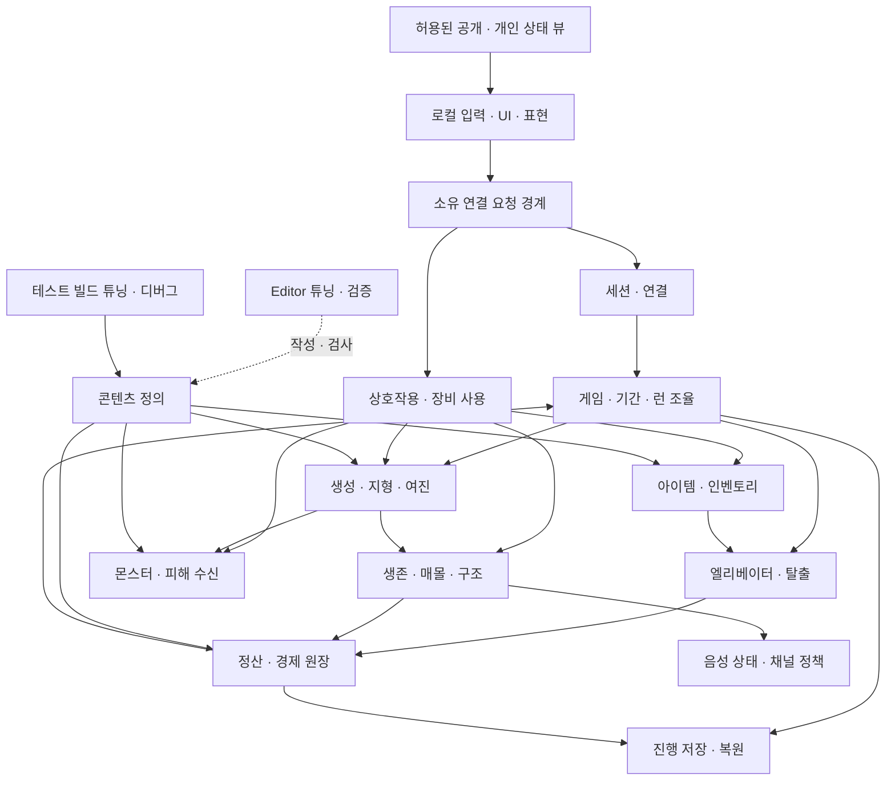

# DIGETHER 전체 시스템 설계

후속 구현 상태: `prototype` 브랜치의 [그레이박스 프로토타입](prototype/PROTOTYPE.md)에서 개발 기능 일부를 시험한다. 아래 `구현 전` 표시는 정식 시스템 전체 계약의 상태이며, 프로토타입의 구현·검증 결과는 연결 문서에서 별도로 관리한다.

## 2026-10-28 작업 목록 반영: 현재 설계 기준

상태: **기획 자료 기반 설계 초안, 구현 전**. 제공된 개발팀 작업리스트 v0.8과 작업목록을 대조했다. 개발팀 문서의 `확정 게임 규칙`은 해당 자료 안의 규칙 상태이며 Notion 이관·팀 승인 또는 구현 완료를 뜻하지 않는다. 서로 다르면 개발팀 문서의 확정 게임 규칙을 우선하고 추가 충돌은 기획 확인으로 남긴다. 자료의 D16·D24·D25·D40은 현재 적용 가능한 시험 방향과 최종 재검토를 구분한다. 기획 운영 원본은 Notion이며 원문 URL·승인 개정은 아직 등록되지 않았다. 셀별 출처는 로컬 작업 기록에 둔다. 기존 DG 요구 ID와 새 S/D/T ID는 각각 다른 체계다.

### 2026-10-29 보정: Steam 판매 기준과 요청 처리 단순화

사용자는 2026-10-29 **Steam 판매**를 출시 방향으로 정했다. 정식 App ID, 세션 서브시스템(내장 OnlineSubsystemSteam 또는 EOS), 음성 제공자, Steam Cloud 사용 여부는 미결이며 [결정 목록](planning/DECISIONS.md)에서 관리한다. 호스트형(리슨 서버) 1~4인 구조를 유지하며 데디케이티드 서버(소스 빌드 엔진 필요)는 현재 범위가 아니다.

요청 처리는 UE 기본 복제 모델에 맞춰 단순화한다. 클라이언트는 소유 PlayerController/Character의 Server RPC로 의도만 보내고, 호스트는 그 RPC 안에서 호출자·단계·거리·대상의 **현재 상태**를 검사한 뒤 같은 실행 안에서 반영한다. 호스트 게임 로직은 게임 스레드에서 차례로 실행되므로 한 함수 안의 검사·차감·지급은 중간 상태를 다른 요청에 노출하지 않는다. Reliable RPC는 엔진이 유실·중복 없이 전달하지만 순서는 같은 액터 안에서만 보장되므로, 다른 액터를 거친 요청 간 선후는 가정하지 않고 도착 시점의 상태로 다시 검사한다([네트워크 권위](unreal/NETWORK_AUTHORITY.md)). 연결이 끊기면 진행 중 RPC는 버려지고 자동 재전송되지 않는다. 이 엔진 동작은 문서·소스 근거이며 프로젝트의 별도 실행 검증은 아니다.

따라서 일반 요청에 클라이언트 요청 ID·예상 버전·준비/확정 단계·요청별 영수증을 두지 않는다. 한 번만 성립하는 대상(줍기·구조 점유·해금·레버)은 두 번째 요청을 "이미 주움·점유 중" 같은 현재 상태 검사로 거절한다. 구매처럼 반복이 정상인 거래는 RPC 한 건을 거래 한 건으로 처리한다. 엔진은 따로 보낸 RPC를 하나로 합치지 않으므로, 실수로 두 번 누르는 경우는 클라이언트 UI의 처리 중 표시·입력 간격과 서버의 요청 빈도 제한으로 막는다. 기간·런 경계를 넘을 수 있는 요청(구매·납부·해금·출발·회수)은 클라이언트가 본 `PeriodId`/`RunId`를 담아 보내고, 서버는 현재 값과 다르면 거절한다. 거절 사유는 소유 클라이언트에 돌려준다. 일반 입력 오류는 연결을 끊지 않고 실패 응답으로 처리하며, RPC `WithValidation`은 정상 클라이언트가 보낼 수 없는 조작 데이터에만 쓴다. 다음 ID·기록만 유지한다.

| 유지 | 이유 |
|---|---|
| 아이템 인스턴스 ID | 같은 아이템이 월드·인벤토리·회수 건 두 곳에 남지 않게 한다 |
| 게임·기간·런 ID와 일차 | 경계를 넘은 늦은 요청을 거절하고, 저장·불러오기 뒤 이전 기간·런 결과가 새 기간에 적용되지 않게 한다 |
| 엘리베이터 편 번호·사망 기록·시체 ID | 편별 성공/취소, 사망 손실과 복구를 한 번만 계산한다 |
| 런 정산 완료 기록 | 저장 복원·재접속 뒤 같은 런을 다시 정산하지 않는다 |
| 지형 revision | 비동기 메시·충돌 결과가 최신 굴착을 덮지 않게 하고 재접속·관련성 복귀 시 스냅샷을 맞춘다(프로토타입 구현) |

여러 프레임에 걸치는 작업(지형 메시·충돌 갱신, 저장 쓰기, Steam/플랫폼 콜백, 구조·레버 같은 진행형 행동)만 완료 시점에 현재 상태와 revision을 다시 확인한다.

Steam 판매 품질을 위해 다음을 우선 강화한다. 실제 검증은 [검증 계획](verification/VERIFICATION_PLAN.md)을 따른다.

- **서버 검증**: 클라이언트가 보낸 거리·대상·수량을 신뢰하지 않는다. 협동 게임이므로 치트 방지보다 아이템 복제·타인 방해·호스트 크래시 방지를 목표로 한다. 호스트 본인의 조작 방지는 범위 밖이다.
- **저장**: 저장 버전·손상 파일 감지, 쓰기 중 종료 시 이전 유효 파일 보존, 구버전 변환([데이터 작업](unreal/DATA_WORKFLOW.md)). Steam Cloud를 쓰면 동기화 충돌 처리.
- **재접속**: Steam UniqueId(또는 채택 제공자의 ID)로 기존 캐릭터·잔고에 연결한다. 표시 이름·IP는 식별에 쓰지 않는다. 현재 `AGameModeBase` 기반이므로 `AGameMode`의 비활성 PlayerState 기능과 직접 구현을 비교한다(미검증).
- **버전 차단**: 빌드 버전이 다른 참가자는 접속 단계에서 거절하고 사유를 표시한다.
- **접속 경로**: 공유기 뒤 친구 간 접속을 위해 Steam 릴레이(SteamSockets) 또는 채택 제공자의 릴레이를 사용한다. 프로토타입은 App ID 480에서 SteamSockets를 시험 중이며 다른 PC WAN 접속은 미검증이다([Steam 시험](prototype/PROTOTYPE_STEAM.md)).
- **호스트 이탈**: 세션 종료는 유지하되 마지막 자동 저장에서 이어 할 수 있음을 결과 화면에 안내한다.
- **음성 기반 몬스터 감지**: 선택 제공자가 호스트에 음성 활동 정보를 주는지 판매 전 최우선으로 시험한다(PQ-13).

구현 규칙과 정의 데이터 구조는 [개발반 구현 설계](design/DEVELOPMENT_SYSTEM_DESIGN.md#구현-규칙)와 [정의 데이터와 태그](design/DEVELOPMENT_SYSTEM_DESIGN.md#정의-데이터와-태그)를 따른다.

### 논리 구성과 의존 방향

화살표는 요청·결과 또는 정의의 흐름이며 소유자의 내부 상태를 직접 수정하는 권한을 뜻하지 않는다. 런 조율자는 단계와 전환을 담당하며 아이템 이동·피해·거래 계산을 각각의 소유자에 위임한다. Editor 도구는 정의를 작성하고 검증하며 런타임은 Editor 모듈에 의존하지 않는다. 테스트 빌드의 튜닝·디버그 실행 경로는 별도로 두고, 변경은 호스트 권한을 통해 확정한다. 테스트용 강제 실행과 디버그 표시는 실제 권한 경계와 분리하고 개발 환경에만 노출한다.

### Unreal 배치 후보와 수명

아래는 구현 착수 시 비교할 후보이며 현재 클래스·API 구현 또는 새로운 엔진 지원 검증 결과가 아니다. 실제 UE 5.8.2 지원·기존 코드 근거는 [엔진 기능 활용 범위](design/UNREAL_FEATURE_COVERAGE.md)와 [프로필](project/PROJECT_PROFILE.md)을 따른다.

| 구성 후보 | 책임과 수명 | 권위·전달 경계 |
|---|---|---|
| 로컬 GameInstance / Subsystem | 접속 UI, 제공자 연결과 로컬 설정. 프로세스/게임 인스턴스 수명 | 각 클라이언트에도 존재하므로 값 자체는 권위 아님. 서버에서 게임 컨텍스트를 보존할 후보로 쓰더라도 월드 전환과 종료 정리를 명시 |
| 호스트 GameMode 계열 | 현재 월드의 단계 진입, 출발·종료 조건 조율 | 권위에서만 실행하는 후보. 클라이언트 UI의 직접 데이터 원본이 아님 |
| GameState 계열 | 공개 단계·일차와 승인된 공통 표시 상태 | 필요한 공개 뷰만 전달. 개인 장부를 공개 복제하지 않음 |
| PlayerState 계열 | 플레이어 ID에 연결되는 공개 상태와 관전 표시 후보 | 소유 연결·맵 전환 시 복원 범위를 검증. 개인 금액을 무조건 넣지 않음 |
| 소유 PlayerController | 로컬 입력과 해당 연결에서 발생한 서버 요청 | 서버는 연결에서 호출자를 결정하고 본문이 주장하는 다른 ID를 신뢰하지 않음 |
| Character/Pawn 및 컴포넌트 | 현재 신체·이동·시점·장착 표현과 입력 보조 | 파괴·재생성 가능. 잔고·사망 기록·정산 완료 기록의 유일한 소유 위치로 사용하지 않음 |
| 서버 도메인 서비스 / 명시적 게임 컨텍스트 | 기간·장부·아이템 소유·런 종료 및 중복 방지 | 호스트 권위 데이터. 월드 또는 프로세스 수명과 전환 인계 방식을 구현 시 선택. 내부 서비스 메모리가 자동으로 복제된다고 가정하지 않음 |
| 월드 Actor / 지역 상태 | 지형, 엘리베이터, 몬스터, 월드 아이템·설치 장비 | 관련 수신자에게 필요한 상태·버전을 전달. 연출 파편은 권위 판정과 분리 |
| 소유자 전용 뷰 | 개인 잔고·허용 인벤토리·거래 결과 | 올바른 연결만 수신. 재접속·관련성 복귀 때 최신 뷰를 구성하고 이전 소유자에게 전달하지 않음 |
| 정의 자산 / Editor 도구 | 승인된 아이템·몬스터·지역·튜닝 정의, 검증과 디버그 지원 | 고정 정의와 런타임 인스턴스를 분리. Editor 의존성이 게임 빌드에 유입되지 않도록 모듈 경계를 검사 |

### 세션·게임·런·월드 인계

| 경계 | 유지·인계할 논리 데이터 | 종료와 실패 조건 |
|---|---|---|
| 세션 연결 | 세션 ID, 호스트·참가자 고유 ID, 연결과 크레딧 상태, 현재 게임 ID | 동일 ID 중복 연결·탐사 중 신규 입장 거절. 재접속은 기존 캐릭터와 현재 자산·사망/정산 상태를 연결. 호스트 이탈 시 연결 종료 안내 |
| 게임 / 기간 | 게임·기간 ID, 일차·목표·누적 인정액·마감 결과, 개인 장부, 팀 해금·목적지, 저장 개정 | 목표 달성은 거래 확정과 새 기간 생성·1일차를 함께 처리. 이전 기간 거래의 늦은 완료는 새 기간에 적용하지 않음 |
| 탐사 / 월드 | 런 ID·시작 일차·출발 인원, 생성 결과와 지형 버전, 플레이어 상태, 아이템 위치, 회수 건과 종료 사건 | 월드 생성과 모든 참가자의 준비가 완료돼야 최초 하강. 출발 로딩 실패는 해당 일차 시작 기준점으로 전체 복원. 쓰기 실패 시 PQ-07 확인 |
| 런 종료 → 거점 | 종료 원인, 생존/사망, 편별 유효 회수 건, 일반·히든·시체 회수 결과, 런 정산 완료 기록 | 종료와 일차 증가는 한 번. 정산·부활·귀환 판정 뒤 저장. 전멸은 기존 회수 건도 최종 보존하지 않음 |
| 게임 오버 → 새 게임 | 고정된 이전 결과, 참가자별 크레딧 상태, 새 게임 ID와 초기화 완료 기록 | 최초 완료 신호에서 한 번 생성. 중복 신호와 늦은 합류는 새 게임을 재초기화하지 않음. 연결 끊긴 크레딧 시청자는 출발 차단 조건에서 제외 |

월드 이동의 구체 방식과 데이터 저장 장소는 후보 비교 후 결정한다. 동일 시드만으로 모든 플랫폼의 생성·충돌 결과가 같다고 가정하지 않으며 기준 상태와 변경 버전, 복구 방법을 실제 구현에서 검증한다.

### 재접속 기술 계약

요구는 같은 고유 ID로 연결을 복원하고, 끊긴 캐릭터를 남겨 그동안의 사망·탈출·정산을 유지하는 것이다. ID 원천과 플랫폼 계정 매핑·인증은 제공자 선정 시 결정한다. 호스트의 재접속 레지스트리는 세션 수명 동안 참가 ID와 연결 상태, 캐릭터·장부 및 현재 상태를 유지하고 표시 이름이나 IP 주소를 식별 근거로 삼지 않는다. 동일 ID의 동시 연결과 게임 빌드 버전 불일치는 거절한다. 튜닝 값 버전이 다르면 경고하고 호스트 기준 값을 동기화한다. 재접속은 인증 → 기존 레코드 검색 → 연결이 끊긴 상태 확인 → 남은 Pawn에 재빙의 또는 이미 사망/탈출했다면 해당 최신 상태 복구 → 허용 뷰와 지역 상태 재전송 순서다. 신규 참가의 자리 배정·생성·지급을 다시 실행하지 않는다. 미접속 참가자 레코드는 이후 저장에도 보존한다. 불러온 저장의 참가자가 같은 ID로 입장하면 저장된 레코드에 연결하고 초기 지급을 반복하지 않는다.

UE 5.8.2의 기본 연결 종료 경로는 PlayerController의 Pawn 정리를 동반할 수 있다. 프로젝트의 GameModeBase에는 GameMode의 비활성 PlayerState 관리가 그대로 제공되지 않으며, GameMode의 기본 inactive 수명·식별 대조도 위 요구를 자동 충족하지 않는다. 따라서 Pawn을 유지하면서 연결/빙의 상태를 분리하는 구현과 수명·재빙의·재인증을 별도로 검증해야 한다. 기존 템플릿의 재접속 실험은 새 ID 참가 관찰이므로 T55의 동일 ID 재접속 통과가 아니다. 엔진 동작은 소스 조사 근거이며 게임 실행으로 검증하지 않았다.

### 튜닝 데이터와 테스트 환경 R01~R14

기획자는 채택된 기능과 D16·D24·D25 시험 프로필을 코드 수정·재빌드 없이 조정한다(R01). 채택 미정 기능과 기본값 공란은 승인 전 구현하거나 승인값으로 채우지 않는다. 플레이어 공통·장비별·몬스터 종별 정의를 분리하고(R02), 각 파라미터 ID를 엔진 필드에 1:1로 연결해 이름이 다르면 매핑을 기록한다(R03). 단위·설명·최소/최대·적용 범위·런타임 변경 Y/N·정의 버전을 레지스트리에 둔다(R09~R10). 잘못된 값은 거절하거나 경고하며 음수 속도/시간과 0 이하 간격을 허용하지 않는다. 중량-속도 등 곡선은 편집 가능한 곡선으로 제공한다(R11).

R04/R13 판정 값은 호스트가 권위를 갖는다. 런타임 변경 Y 값은 호스트에서 유효성을 확인하고 동일 버전으로 동기화하며, 화면 전용 설정은 분리한다. 버전이 다른 클라이언트는 경고한다. 다인 테스트 빌드에서도 변경·동기화와 선택적 디버그 표시가 동작해야 하므로 Editor 모듈 없이 읽을 수 있는 런타임 데이터·테스트 전용 제어 경로를 둔다. 변경 이력을 비교할 수 있는 CSV/JSON 등 텍스트 원본과 엔진 데이터 가져오기·검증 경로를 후보로 비교한다(R14). 원본과 산출물 불일치·버전 충돌은 경고하고 기준을 결정하기 전 자동 덮어쓰지 않는다. 프로필은 묶음 저장·전환하고 테스트 빌드 입력은 별도 프로필로 기록한다(R12, 권장).

운행 횟수와 사망/복구 비율처럼 탐사별 결과를 고정하는 값은 거점에서 변경하고 런 생성 시 버전 있는 프로필 스냅샷에 보관한다. 엘리베이터 횟수(ELV_ASCENT_LIMIT), 탐사 제한 시간(RUN_TIME_LIMIT), 사망 손실(PLY_DEATH_LOSS_RATIO)·시체 복구 비율(CORPSE_REFUND_RATIO)은 런 시작 시 고정하고 진행 중 소급 변경하지 않으며 사망·정산 재처리에도 같은 스냅샷을 사용한다. 시간 제한·상승 시간 차감량은 런 설정과 실제 적용 버전을 기록한다. 런타임 조정 가능 항목은 승인된 적용 시점과 변경 사건을 기록하여 재현하며, Y/N을 임의로 바꾸지 않는다. 1회/2회 프로필 비교는 다음 탐사에 적용한다(T65).

몬스터 BT의 노드 구성은 미설계다. 노드형 편집기를 이용해 테스트 조건·순서를 코드 없이 바꾸고(R05), 종별 데이터 참조와 명시적 노드 덮어쓰기(R06), 지원 노드·기존 데이터 복제에 의한 테스트 종 생성(R07)을 제공한다. 테스트 빌드/Editor에서 시야·청각·현재 노드·대상·경로 및 랜턴 범위·상호작용 거리를 켜고 끄며 판정 범위와 일치시킨다(R08). UE Behavior Tree 편집기와 Gameplay Debugger/Visual Logger는 검토 후보이며 이 문서에서 5.8.2 지원·프로젝트 연결을 새로 확인한 것은 아니다. T40에서 필드·단위·범위·런타임 반영과 호스트 버전을 검증한다.

### 출발·운행·종료 장벽

출발 레버 완료 요청은 호스트가 단계·크레딧 잠금과 기간 버전을 확인한다. 진행 중인 구매·납부는 확정 또는 취소로 정리하고 정산머신·해금 패널·하우징 점유를 해제하며 미확정 배치는 이전 유효 위치를 유지한다. 4일차에는 마감 판정을 그 처리 순서와 함께 확정한다. 출발 장벽과 거래가 겹쳤을 때 한쪽의 부분 결과가 다른 단계에 남지 않게 한다. 목적지 고정 시점은 D28 확인 전 임의로 확정하지 않는다.

일반 편은 `대기 → 게이지 완료/명세 고정 → 문 닫힘·상승 → 도착 성공 또는 출발 취소`로 모델링한다. 탑승자는 운행 중 별도 상태로 기록하며 목록 고정과 실제 탈출 성공을 구분한다. 결론 나지 않은 운행이 남았으면 탐사 종료 확정 자체를 기다리는 기술 장벽을 둔다. 종료 확정 순간 생존자를 고정하고 일차를 한 번 증가시킨 뒤 정산한다. 활동 인원에서 빠지는 시점, 운행 중 탑승자의 사망 가능성, 출발 취소 사유는 기획 확인 전 최종 판정하지 않는다. 시간 종료가 상승 중 발생하면 해당 편을 마치고 추가 회수 건을 만들지 않는다. 호스트가 목록 고정·시간 종료 시점의 위치와 튜닝된 탑승 영역을 기준으로 내부 여부를 판정하고, 끊긴 캐릭터와 소지품을 포함하되 손에 든 물건을 바닥 화물로 중복 합산하지 않는다. 문턱 범위는 플레이 테스트 값이다.

호스트 단일 시계의 남은 제한 시간으로 여진 일정을 계산한다. 상승 확정당 시간 감소를 한 번 적용하면 여진 일정을 새 남은 시간에 맞춰 재평가하고 0이 되면 진행 편은 유지한 채 시간 종료를 한 번 처리한다. 첫 상승 후 여진 간격 배율은 별도의 테스트 값으로 관리하며 기본값은 미정이다. 제한 시간의 정확한 시작 시점은 기획 확인이 필요하다.

### 저장 기준점과 복구

일차 시작의 완료 상태를 식별하는 별도 기준점을 유지한다. 수동 저장이 자동 저장 기준점을 덮지 않도록 저장 슬롯 또는 논리 버전을 분리하는 방안을 제안한다. 기준점에는 기간·일차·목표·인정 누계·마감 결과, 개인 잔고·히든 누적 수익·장비·통계·사망/복구·런 정산 완료 기록, 팀 해금·목적지·배치, 미접속 참가자 기록과 5일차 실패 대기 상태를 포함한다. 게임 오버 이전의 고정 결과는 새 게임 초기화와 분리해 보존한다. 불러오기 실패 때 기존 저장을 새 게임으로 덮어쓰지 않고, 새 게임 생성 시에도 이전 저장을 지우거나 덮어쓰지 않는다. 불러온 실패 대기는 일반 거점으로 풀지 않는다.

자동 저장 쓰기 실패 시 이전 파일을 보존하되 전날 기준점으로 현재 일차의 출발 실패를 복원했다고 주장하지 않는다. 메모리 기준점 유지 또는 저장 성공 전 출발 차단은 기획·기술 확인이 필요한 선택이다. 기준점 이후 참가·이탈이 있었을 때 복구 후 세션 구성은 확인 대기이며 그 전에는 최종 정책을 구현하지 않는다. 명시적 미결은 [결정 목록](planning/DECISIONS.md)의 추가 확인 항목을 따른다. 장애·수동 저장 경합·미접속 레코드·실패 대기 불러오기를 검증한다.

### 기능 소유 매핑과 착수 단위

| 기능 ID | 주 소유 영역 | 연결·착수 시 필요한 계약 |
|---|---|---|
| S01 | 세션 | 방·연결·재접속과 ID, 게임 컨텍스트 복원 |
| S02 | 런·기간 | 출발 게이지·자동 탑승·일차와 마감, 목적지 |
| S03 | 플레이어 | 이동·시점·체력과 스태미나, 생존 제한 |
| S04 | 상호작용 | 탐색과 서버 자격 검증, 점유·취소 |
| S05 | 월드 생성 | 갱도·던전 연결, 생성 검증·준비 실패 |
| S06 | 장비·표현 | 채택 광원과 환경 장치, 설치 상태 |
| S07 | 지형 | 갱도 허용 3D 흙 볼륨의 실제 제거·메시·충돌과 던전 지정 벽 파괴 |
| S08 | 지형·보강 | 설치·손상·무료 보수와 소모 거래 |
| S09 | 지형·시간 | 여진 일정·붕괴·재굴착, 충돌·경로 갱신 |
| S10 | 생존·구조 | 매몰 단계, 단독 점유와 취소·사망 경합 |
| S11 | 아이템 | 일반·헤드랜턴 슬롯과 인스턴스 보관 |
| S12 | 아이템·플레이어 | 중량·양손 제한과 이동 속도 |
| S13 | 아이템 | 히든 칸·비공개 뷰·중량 |
| S14 | 아이템·월드 | 배치·획득·낙하·유형별 보존 |
| S15 | 엘리베이터 | 운행 상태·횟수·중량·시간 감소 |
| S16 | 엘리베이터·아이템 | 게이지 완료 명세·편별 성공/취소 |
| S17 | 탈출·생존 | 개인 탈출·관전 전환·장비 제한 |
| S18 | 런·생존 | 시간 종료·사출·전멸·일차 전환 |
| S19 | 경제 | 유효 화물·출발 인원·생존자 정산 |
| S20 | 경제·아이템 | 개인 히든 지급과 지속 장비 보존 |
| S21 | 생존·경제·아이템 | 사망 사건·드롭·지갑 손실 |
| S22 | 생존·경제 | 시체 운반·복구·관전·부활 |
| S23 | 경제·아이템 | 개인 구매와 차감·인스턴스 발급 |
| S24 | 기간·경제 | 납부 점유·목표 달성·4일차 마감·실패 |
| S25 | 몬스터·월드 | 종별 정의·생성·행동·동적 지형 경로 |
| S26 | 장비·생존·몬스터 | 동일 입력의 굴착/공격 판정·팀킬 |
| S27 | 장비·아이템 | 설치·사용·보존, 자원 채택 여부 |
| S28 | 음성 | 거리·관전 채널·제공자 연결 |
| S29 | 표현·UI | 허용 정보·경고·결과와 안내 |
| S30 | 저장 | 완료 상태·버전·복원과 권한 |
| S31 | 로컬 설정·표현 | 입력·음향·접근성과 오류 |
| S32 | 개발 검증 | 재현·로그·데이터 검증, 권한 분리 |
| S33 | 게임 흐름·표현 | 실패 결과 고정·크레딧·새 게임 생성 |
| S34 | 외형 | P2 동기화·판정 분리·저장 범위 결정 |
| S35 | 거점 배치 | P2 권위 점유·공간 검증·저장 복구 |

S01 참가 거절은 정원 초과·버전 불일치·방 종료·참가 불가 상태로 구별한다. S02의 시작 장비·기본 목재는 승인된 시작 지급 데이터에 따라 한 번만 지급하며 수량과 목재 위치의 충돌은 D22/PQ-04 확인 대상이다. S05는 고정 테스트 맵으로도 한 판을 검증하고 생성 맵과 결과를 구분한다. S24는 목표 달성 시 현재 납부 입력을 끊고 새 기간에서 다시 입력해야 한다. S33 통계는 게임/플레이어 ID와 참가 순서를 기준으로 증분 누적하며 0원도 표시한다. 이전 게임 결과를 고정한 뒤 크레딧을 재생하고, 종료 모션 실패 시 실패 화면으로 전환할 복구 경로를 검증한다.

### 게임 흐름과 상태 전이

호스트가 방을 만들고 최대 4명이 참가하며 1인 완주도 지원한다. `거점 준비 → 출발 로딩 → 최초 하강 → 탐사 → 종료 확정 → 런 정산 → 거점 귀환 판정 → 거점 준비`가 기본 흐름이다. 모든 참가자가 출발 레버를 당길 수 있고 준비 확인은 없다. 게이지 완료 시 모두 엘리베이터에 이동한다. 로딩 실패는 해당 일차 시작 기준점으로 전체 진행을 복원한다. 기준점 쓰기 실패 시 처리는 PQ-07 확인 대상이다. 탐사 중 신규 참가는 금지하되 기존 ID의 재접속은 신규 참가와 구별한다. 호스트 종료 시 참가자 연결이 끊긴다.

탐사 종료는 활동 인원 0, 최종 허용 상승 종료, 시간 종료의 자동 귀환 처리 완료 중 해당 사건으로 한 번 확정한다. 그 즉시 일차를 한 번 증가시키고 종료된 탐사 ID로 정산한다. 정산·복구금·지급 완료 기록·부활과 귀환 판정이 모두 반영된 뒤 자동 저장한다. 4일차 출발 게이지 완료 시 납부를 마감하고 당시 미달을 기록한다. 미달이어도 출발하며 탐사 후 5일차 거점에서 종료 모션 → 실패 화면 → 결과 크레딧을 표시한다. 목표 달성 시에는 즉시 새 목표와 1일차로 전환하고 진행 중 출발 입력을 취소한다. 결과 크레딧은 각자 빨리감기만 가능하고 첫 완료 신호로 새 게임을 한 번 생성한다. 늦게 크레딧을 마친 사람은 같은 게임에 합류하며, 연결이 유지된 누군가가 크레딧을 보는 동안 출발을 막는다.

### 책임·수명과 정보 경계

다음 표는 논리 소유자 후보로 클래스·실제 API를 확정하지 않는다. 호스트 권위는 제공 자료의 방향이며 전송 구현·플랫폼 제공자는 미정이다. 클라이언트는 의도를 요청하고 호스트는 호출자의 연결, 단계, 자격, 대상과 현재 상태를 확인해 확정한다.

| 영역과 요구 | 권위 상태·수명 | 주요 계약과 경계 |
|---|---|---|
| 세션 S01 | 세션/게임 ID, 참가자·연결, 크레딧 및 새 게임 생성 상태; 세션 수명 | 고유 플레이어 ID로 재연결; 빈자리 검사·초기 지급을 반복하지 않음. 끊긴 캐릭터는 그 자리에 남음 |
| 런·기간 S02/S18/S24/S33 | 런 ID, 단계·시작 일차·종료 사건, 기간 ID·목표·마감 결과; 게임 수명 | 전환 ID와 선후 관계로 종료·일차 증가·마감을 각각 한 번 확정. 목표 달성 거래와 새 기간 전환을 함께 처리 |
| 플레이어 S03/S10/S21/S22 | 체력·매몰·생존/탈출·사망 사건·연결 상태; 런 및 결과 보존 기간 | 탈출과 사망 중 먼저 승인한 하나만 확정. 사망/실종은 같은 처리이나 결과 표시를 구별. Pawn이 사라져도 사망 기록과 개인 장부는 유지 |
| 상호작용·장비 S04/S26/S27 | 사용 자격·진행/점유·행동 ID; 대상 또는 행동 수명 | 호스트가 거리·상태·장비를 재검사. 굴착과 공격은 같은 입력이지만 결과는 각 수신 도메인이 판정. 처치 가능한 몬스터와 팀킬을 지원하며 전투 전용 무기는 범위 밖 |
| 인벤토리 S11~S14 | 고유 아이템 ID, 정의·위치·소지자·슬롯·개별 상태; 진행/런 수명에 따라 분리 | 일반 4칸, 헤드랜턴 전용 1칸, 히든 1칸, 시체 전용 1칸. 한 아이템은 월드·인벤토리·유효 회수 건 중 한 곳에만 존재. 장비는 소유권 없이 주운 사람이 보유 |
| 지형·생성 S05/S07~S09 | 생성 명세·지역·굴착 볼륨과 변경 버전·보강·여진 일정; 런 수명 | 갱도의 허용 3D 흙 볼륨은 조준 지점에서 실제로 깎여 옆·아래로 확장된다. 벽·바닥·천장 방향과 무관하게 허용 영역만 제거하며 던전은 지정 파괴 벽만 변경한다. 메시·충돌·경로를 변경과 함께 일관되게 갱신. 보강 손상은 무료 보수, 붕괴 구간은 재굴착 |
| 엘리베이터 S15~S17 | 운행 상태·상승 횟수·중량·레버 진행·회수 건; 런 수명 | 게이지 완료 순간 사람·화물을 동결하되 성공 여부는 운행 결과로 확정. 중량 초과는 출발·고정·회차 소비를 막고 진행 중 초과 시 게이지 초기화 |
| 경제 S19~S24 | 개인 잔고, 거래·사망·복구 원장, 기간별 목표와 인정액; 게임 수명 | 일반 화물과 히든, 장비, 복구금을 구분. 한 서버 함수 안에서 검사·차감·지급해 경합에 중복 차감/지급 방지. 개인 잔고·납부와 히든 상세는 비허용 클라이언트에 전달하지 않음 |
| 몬스터·음성 S25/S28 | 종별 정의와 개체 상태, 음성 채널·연결; 개체/세션 수명 | 지형 변화 후 경로를 재평가. 종별 행동과 BT 노드는 미설계. 살아 있는 탐사자와 관전자의 음성 경로를 분리하고 벽 감쇠는 적용하지 않음 |
| 저장·설정 S30~S32 | 버전 있는 완료 상태, 진행 저장과 로컬 설정; 게임/기기 수명 | 자동 저장은 완료 경계에서만, 수동 저장은 호스트만. 허용 상태 D29 미정. 실패 시 이전 유효 저장 보존. 실게임 정보와 진단 로그의 공개 범위를 분리 |
| 외형·하우징 S34/S35 | 플레이어 외형과 거점 오브젝트 배치; P2 후속 | 외형은 충돌·능력에 영향 없음. 배치는 호스트가 겹침과 동선·사용 공간을 검사. 배치는 진행 저장 단위, 새 게임은 기본 배치. 외형 저장 범위 D33 미정 |

### 실제 굴착과 프로토타입 표현

2026-10-28 사용자 최신 지시는 Digging a Hole처럼 조준한 흙을 실제로 깎아 구멍을 넓히고 아래로 내려가는 경험이다. 기존 ‘지정 굴착 가능 오브젝트’라는 표현은 허용된 3D 지형 영역의 경계로 해석하며 액터 축소를 수용 결과로 삼지 않는다. T02~T03의 비허용 지형 보존과 동시 굴착 실제 제거량 조건, 던전 지정 벽 규칙을 함께 만족해야 한다. [굴착 구현 설계](design/EXCAVATION_IMPLEMENTATION.md)는 서버 검증·복제 스냅샷·메시와 충돌 변경·보강·재접속의 현재 구현 계약과 미검증 범위를 구분한다.

초도 runtime 굴착 시험은 8m × 8m, 지표 아래 약 2.5m 격자(보호된 최하층을 빼면 실제 굴착 가능 깊이 약 2.15m)의 한정 볼륨과 벽 방향 회전 시험을 대상으로 한다. 이 크기·깊이·회전 시험은 최종 갱도 규모나 모든 방향의 패키지 수용 완료를 뜻하지 않는다. 넓은 갱도·던전으로의 확장과 청크화는 별도 후속 범위다. 신규 프로토타입/새 게임의 기본 삽 1개·2kg 지급은 조작 가능한 플레이 시험을 위한 fixture이며 D22의 정식 시작 지급품·중량을 확정하지 않는다.

어두운 Low Poly 광산·따뜻한 작업등·목재 보강·철제 승강기·1인칭 도구·폐교 분위기를 표현 목표로 삼는다. HUD는 조준 대상과 행동 가능 여부, 장비, 보강·붕괴 위험을 읽을 수 있게 구성한다. 제공 이미지에 보이는 수분 등 추가 자원이나 미채택 장비를 새 규칙으로 만들지 않는다. 표현 목표와 실제 구현·빌드·다인 검증 완료는 [프로토타입 상태](prototype/PROTOTYPE.md)에서 구분한다.

### 회수·정산·예외 처리

- 일반 엘리베이터는 최초 하강 → 1차 상승 → 자동 재하강 → 최종 상승이다. 2회는 D24의 현재 시험 프로필이며 1회 비교도 가능해야 한다. 1차 탈출자와 긴급 탈출자는 관전자로 전환하고 탐사에 재합류하지 않는다. 긴급 탈출은 본인만, 회수품·시체 없이 진행하며 관전 전환 시 확정한다.
- 시간 종료 시 갱도 대기 중 정상 중량이면 자동 최종 상승하고 초과라면 사람·소지품·화물·시체를 사출한다. 사출 화물은 해당 편에서 제외한다. 이미 상승 중이면 해당 편으로 귀환하고 추가 회수 건을 만들지 않는다. 위층 대기 또는 빈 재하강이면 추가 회수를 중단하고 귀환한다. 최종 상승 후 잔류자와 시간 종료 잔류자·사출자는 사망으로 처리하고 결과에만 실종으로 표시한다. 상승 확정당 남은 시간 감소를 한 번 적용하고 0 아래로 내리지 않는다.
- 유효 회수 일반 화물 총액 T를 탐사 출발 인원 N으로 나눈 몫을 소수점 버림한다. 생존 탈출자는 각 한 몫을 받고 사망·실종자의 몫과 나머지는 소멸한다. D16은 플레이테스트 후 최종 재검토하되 현재 방식은 시험 가능하다. 전멸이면 이전에 올린 화물·장비·시체도 사라진다(장비·시체는 테스트로 조율). 히든 회수품은 생존 소지자 개인에게 지급하고 일반 분배에서 제외한다. 히든 슬롯과 게임 오버 시 히든 수익 공개는 함께 도입하거나 함께 제외한다. 장비는 정산 소비 대상이 아니며 회수된 장비는 이후 사용할 수 있다.
- 사망 시 개인 잔고 100% 손실, 회수한 시체의 사망 직전 잔고 50%를 내림해 사망자에게 복구하는 것은 D25의 시험 기준이다. 정산 전 수익과 이미 납부한 금액은 사망 당시 잔고에서 차감하지 않는다. 복구는 새 수익이 아니며 순손실은 실제 차감액에서 실제 복구액을 뺀 값이다. 시체 회수는 일반 화물 분배 자격을 복원하지 않는다. 시체 무게는 0이며 별도 슬롯으로 양손 운반한다.
- 같은 대상 구조는 호스트가 먼저 승인한 한 명만 진행한다. 중단·거리 이탈·연결 끊김·구조자 사망에서 진행을 초기화하고 점유를 해제하며 완료·대상 사망에도 해제한다. 단독 플레이에서 3단계 매몰은 사망, 전원 매몰은 주기 피해를 따른다. 일반 작업목록의 다수 동시 구조 설명과 충돌하므로 개발팀 규칙을 따른다.
- 납부는 한 번에 한 명, 정수 금액, 초과 납부·환불 없이 처리한다. 목표 달성은 즉시 다음 기간을 시작한다. 차감 최소 단위·인정액 절사와 나머지 이월은 D27 미정이므로 임의로 확정하지 않는다. 갱도 해금은 요청자의 잔고에서 비용을 차감하고 팀에 공유하며 동시 요청 중 첫 확정만 차감한다. 목적지 변경과 출발 경합은 D28 미정이다.

### 데이터·실패·구현 및 검증 계획

정의 데이터(아이템 종류·중량·가치, 장비, 생성·몬스터·튜닝)와 가변 데이터(인스턴스 위치, 잔고·거래, 런/기간 상태, 회수 건)를 분리한다. 단위는 kg·m·초·정수 재화다. 모든 외부 요청은 호출자·대상·단계와 현재 상태를 검사하고 확정 결과 또는 거절 사유를 반환한다. 일회성 대상의 동시·반복 요청은 현재 상태 검사로 한 번만 반영하고, 구매처럼 반복이 정상인 거래는 요청마다 별도로 처리한다. 지형 충돌·경로 갱신이 준비되지 않았거나 생성/정산/저장이 실패하면 정상 완료를 표시하지 않고 기존 유효 상태를 보존한다. 전송·저장 원자성의 구체 구현은 기술 검증 대상이다.

| 처리 | 확인·확정 경계 | 실패·경합 |
|---|---|---|
| 아이템 획득·이동 | 현재 위치와 빈 슬롯·자격을 확인하고 이전 위치 제거와 새 위치 등록을 하나의 확정으로 처리 | 경쟁에서 진 요청은 거절. 동일 ID가 두 보관 장소에 남지 않음 |
| 구매·해금·납부 | 권위 가격/정의, 잔액·단계·점유를 확인하고 요청의 `PeriodId`를 현재 기간과 대조. 차감과 지급 또는 팀 해금·인정액 반영을 한 서버 함수 안에서 함께 처리 | 검사 실패 시 아무것도 바꾸지 않고 사유 반환. 해금·납부 점유는 중복 거절, 구매는 요청 한 건당 한 건이며 실수 연타는 UI·빈도 제한으로 차단 |
| 회수·정산 | 편별 동결 목록과 운행 성공을 따로 기록하고 런 종료 후 출발 인원·생존 여부·유효 화물을 확정. 아이템 소비와 지급·완료 기록을 연결 | 취소된 편과 이전 성공 편을 구별. 같은 런의 재정산은 잔고·히든·복구액을 다시 바꾸지 않음 |
| 사망·복구 | 사망 이벤트별 사망 전 잔고·손실 및 시체 ID를 연결. 유효 회수 결과로 사망자에게 복구하고 결과에 순손실을 기록 | 동일 사망·회수 사건은 한 번. 시체 회수가 일반 분배 자격을 되살리지 않음 |
| 저장·복원 | 완료된 일차/기간·잔고·장비·팀 해금·목적지·배치·지급 완료 기록을 같은 기준점으로 기록 | 쓰기 실패 시 이전 유효 저장 보존; 로딩 실패 시 해당 일차 시작 스냅샷으로 저장 이후 변경 전체 복원. 구버전·손상과 중복 지급을 검사 |

일반 요청의 결과는 별도 저널 없이 현재 상태로 남긴다. 저장 복원 뒤 재지급을 막는 런 정산 완료 기록만 저장에 포함한다. 저장 형식과 장애 복구 구현은 정하지 않았다. 점유·예약은 완료·취소·연결 해제·대상 소멸에 정리하고 늦은 응답은 현재 버전과 자격을 재검사한다. 매몰 구조처럼 정해진 종료 조건은 각 도메인 규칙을 따른다.

개발 순서는 자료의 ① 기반 S01~05/S11~12/S14/S32 → ② 굴착·일반 엘리베이터와 종료 S07/S15~18(긴급 장치는 ⑥) → ③ 경제 S19/S21~24 → ④ 몬스터·팀킬·음성 S25~26/S28 및 남은 시간에 따른 여진 → ⑤ 보강·붕괴·구조 S08~10 → ⑥ S06/S13/S17 긴급 장치/S20/S27/S29~31/S33 → ⑦ 콘텐츠와 P2 외형·하우징을 따른다. 각 단계의 기능은 의존성을 선행 검증하고, 우선순위와 Must/Should/Could는 서로 다른 분류다. 산소·차량·날씨·전투 전용 무기·엘리베이터 업그레이드 등 보류 항목은 선행 공통 기능이라는 이유로 구현하지 않는다. BT 편집·종별 튜닝·디버그 환경 요청은 유지하되 노드 구성은 만들지 않는다.

검증은 문서 L1에서 출처·충돌·링크·정책을 확인하고, 구현 후 L1~L3/M2에서 1~4인, 동시 획득·구조, 1/2회 운행·초과·운행 중 시간 종료, 생존/전멸 정산, 목표 조기 달성·4일차 마감, 저장 실패·출발 복원·재접속 및 비공개 데이터 전달을 검사한다. 음성·플랫폼은 실제 제공자 환경의 M3가 필요하다. 테스트 기본값과 미정 항목은 결과에 명시한다. 이 문서의 시나리오는 실행 증거가 아니다.

남은 주요 기획은 D15~D23, D26~D34, D40의 상세 항목과 D16/D24/D25의 최종 플레이테스트 판정이다. 특히 시작 아이템·가격·목표와 증가량·납부 효율, 최초 몬스터 종, 플랫폼/음성 제공자, 수동 저장 허용 상태, 목적지 경합, 외형 획득·저장 범위는 승인값이 없다. 구체 목록은 [결정 목록](planning/DECISIONS.md)을 따른다.

